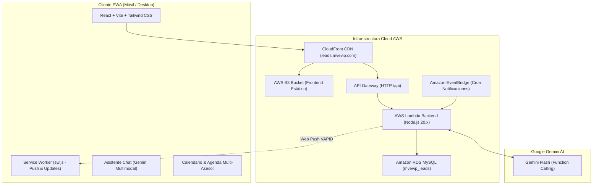

# MEMORIA TÉCNICA - MVEVIP LEAD REMINDER & ASISTENTE IA

**Proyecto:** MVEVIP Leads & Recordatorios (PWA)  
**Versión Actual:** 1.0.6  
**Dominio de Producción:** [https://leads.mvevip.com](https://leads.mvevip.com)  
**Repositorios:**  
- Personal (respaldo y actividad): [https://github.com/caloloc2/mvevip_leads_agente](https://github.com/caloloc2/mvevip_leads_agente)  
- Empresa (colaborador principal): [https://github.com/mvevip/mvevip-leads-app](https://github.com/mvevip/mvevip-leads-app)  
**Fecha:** 21 de Octubre de 2026  

---

## 1. Resumen Ejecutivo

MVEVIP Lead Reminder es una Aplicación Web Progresiva (PWA) de alto rendimiento diseñada para la fuerza comercial de MVEVIP. Su objetivo es centralizar la gestión de clientes potenciales (leads), citas y recordatorios diarios mediante notificaciones Push nativas en dispositivos móviles y un asistente conversacional inteligente impulsado por **Google Gemini AI**.

El asistente permite a los asesores y administradores interactuar por voz, texto o imágenes directamente con la base de datos de producción (`mvevip_leads`), realizando consultas inteligentes, reagendando citas, actualizando estados y analizando cotizaciones, manteniendo estrictas reglas de seguridad y privacidad por rol.

---

## 2. Arquitectura del Sistema



### Componentes de Infraestructura:
- **Frontend:** React 18, Vite 5, Tailwind CSS, Lucide Icons, Date-fns. Empaquetado como PWA instalable con Service Worker para soporte offline y recepción de notificaciones Web Push.
- **Backend:** Node.js 20, Express, Prisma ORM / mysql2, `@google/genai` (SDK oficial Gemini), `web-push` para entrega push sin costes de terceros.
- **Modo Local:** Entorno orquestado en Docker Compose en puertos aislados (Frontend: `6410`, Backend: `6411`, MySQL: `6412`).
- **Producción Cloud AWS:**
  - **S3 Bucket:** `s3://mvevip-leads` (región `us-west-2`).
  - **CloudFront:** Distribución `E2FMW6HOSKOVMP` con origen dual (S3 para estáticos y API Gateway para `/api/*`).
  - **Lambda Function:** `mvevip-lead-api` ejecutando Express encapsulado mediante `serverless-http`.
  - **RDS MySQL:** Instancia MySQL gestionada en AWS VPC.
  - **EventBridge:** Regla cron ejecutada cada minuto para despachar recordatorios pendientes de forma desatendida.

---

## 3. Características y Mejoras Implementadas en Esta Sesión

### 3.1. Asistente Virtual Inteligente (Gemini Flash con Tool Calling)
- **Integración Multimodal:** Procesa mensajes de texto, notas de voz y fotografías/capturas de clientes directamente en el chat.
- **Herramientas de Base de Datos (Function Calling):**
  - `consultar_base_datos`: Ejecución de consultas `SELECT` directas y optimizadas sobre las tablas del sistema.
  - `actualizar_estado_lead`: Modificación ágil de estados (`NUEVO`, `CONTACTADO`, `COTIZADO`, `SEGUIMIENTO`, `CERRADO_GANADO`, `PERDIDO`).
  - `crear_o_reagendar_recordatorio`: Creación y actualización de citas/tareas vinculadas a un lead y un asesor.
  - `actualizar_datos_lead`: Modificación de datos de contacto y notas del prospecto.
- **Blindaje y Seguridad Estricta de la BD:**
  - **Ámbito Exclusivo:** El asistente tiene estrictamente prohibido consultar o referenciar bases de datos fuera de `mvevip_leads`.
  - **Prohibición de Eliminación:** Las operaciones `DELETE`, `DROP`, `TRUNCATE` o `ALTER` están bloqueadas a nivel de validación de servidor y de prompt de sistema. Si un usuario solicita borrar información, el asistente únicamente puede desactivar o cambiar estados a inactivo/perdido.
  - **Aislamiento por Rol:** Los asesores solo reciben información de sus propios leads. Los administradores ven sus registros por defecto y únicamente consultan a otros asesores cuando lo solicitan de forma explícita.
- **Tono Conversacional 100% Natural:** Se retiraron mensajes técnicos internos ("BD en vivo", "Consultando la BD...", "BD sincronizada"). El asistente responde de forma fluida, cordial y directa como un colega de operaciones.

### 3.2. Calendario y Agenda Multi-Asesor
- **Página de Agenda Renombrada:** La vista de inicio ahora da protagonismo al Asistente IA, mientras que los eventos y recordatorios se gestionan en la pestaña "Agenda".
- **Selector Dinámico para Administradores:**
  - Menú desplegable interactivo con checkboxes individuales para filtrar por uno, varios o todos los asesores comerciales.
  - Accesos rápidos: *"Solo yo"* y *"Todos"*.
  - Por defecto se carga el perfil del usuario activo para evitar saturación visual.
- **Badges de Asignación en Línea de Tiempo:** Cada tarjeta de recordatorio muestra claramente el nombre del asesor responsable cuando se visualizan agendas combinadas.
- **Navegación Móvil:** Soporte táctil de deslizamiento (swipe horizontal) para cambiar entre días (ayer, hoy, mañana, etc.), junto con controles superiores de fecha.

### 3.3. Experiencia Visual Móvil & PWA
- **Ajuste del Notch / Barra Superior (`safe-top`):** Se adaptaron los encabezados con `padding-top: env(safe-area-inset-top)` para evitar que la cámara frontal o notch de dispositivos móviles tape el avatar o botones.
- **Color de Barra de Estado Dinámico (`theme-color`):** Sincronización del meta-tag HTML para que la barra de estado de Android e iOS coincida exactamente con el fondo de la aplicación (`#F8FAFC` en modo claro y `#121212` en modo oscuro), eliminando el color azul desalineado.
- **Optimización de Scroll en Chat:** Se eliminaron scrolls dobles e innecesarios en pantallas pequeñas para permitir una lectura continua del historial.

### 3.4. Sistema de Notificaciones y Actualizaciones PWA
- **Resolución de Bucle de Actualización:** Se unificó la versión a `1.0.4` en `version.js`, `public/version.json` y el Service Worker `sw.js`. Se corrigió el listener de `UpdateContext.jsx` para evitar que vuelva a sugerir actualizar una vez que la versión actual ya está instalada.
- **Notificaciones Web Push:** Configuración 100% gratuita con VAPID, con almacenamiento de subscripciones por dispositivo y compatibilidad completa con Safari en iOS 16.4+ y Google Chrome en Android.

### 3.5. Versión 1.0.6: Estación de Trabajo Desktop Unificada, Alertas Hápticas/Sonoras y Drag & Drop
- **Estación de Trabajo Unificada en Desktop (Split-Screen en `lg: >= 1024px`):**
  - **Panel Izquierdo (Chatbot Asistente IA):** Integra de forma permanente el chatbot multimodal con Gemini Flash, carga de fotos por drag & drop, pegado de capturas con `Ctrl + V` y notas de voz.
  - **Panel Derecho (Calendario y Agenda):** Despliega el calendario completo con selector de fechas, tarjeta semanal interactiva `ProgressCard`, filtro multi-asesor con checkboxes, barra de búsqueda `SearchBar`, switch de `Pendientes` vs `Realizados`, y la línea de tiempo de compromisos con scroll independiente.
  - **Móviles y Tablets Pequeñas (`< lg`):** Conserva la navegación táctil optimizada para teléfonos con `BottomNav` para alternar entre el Asistente y la Agenda con gestos swipe.
  - **Navegación Adaptativa:** En desktop (`lg:`), el menú superior unifica el acceso principal como **"Agenda & Asistente IA"**, junto a **"Alertas"** y **"Perfil"**.
  - **Perfil en Grid:** La pantalla de configuración y perfil se organiza en cuadrícula de dos columnas (`grid-cols-1 md:grid-cols-2`).
- **Sonido y Vibración en Notificaciones Push:**
  - **Web Audio API Chime:** Sintetizador de tonos en primer plano sin descargas externas (`soundService.js`) con acordes D5 -> A5 y decaimiento exponencial natural de campana.
  - **Patrones Hápticos de Vibración:** Inclusión de patrón `[200, 100, 200, 100, 200]` con opciones `silent: false` y `renotify: true` en el Service Worker.
  - **Control de Usuario:** Switch de activación/silencio y botón de prueba interactivo en la pestaña de Perfil.
- **Drag & Drop y Soporte de Portapapeles (`Ctrl + V`) en Asistente IA:**
  - Detección de arrastre de imágenes sobre la ventana del chat con overlay visual verde lima (`#9AC31C`) y borde punteado interactivo.
  - Soporte de pegado directo desde portapapeles (`onPaste`) para capturas tomadas con herramientas de recorte (`Win + Shift + S`) o copiado de imágenes.

---

## 4. Estructura del Proyecto

```
mvevip_lead_app/
├── client/                     # Frontend React Vite PWA
│   ├── public/                 # Iconos PWA, manifest.json, version.json
│   ├── src/
│   │   ├── components/         # AssistantChatView, CalendarAgendaView, TimelineView, etc.
│   │   ├── context/            # AuthContext, ThemeContext, UpdateContext, NotificationContext
│   │   ├── pages/              # HomePage, LoginPage, LeadsPage, SettingsPage
│   │   └── services/           # api.js, pushNotificationService.js
│   ├── index.html
│   └── vite.config.js
├── server/                     # Backend Express API & Lambda Handler
│   ├── prisma/                 # Esquema Prisma (schema.prisma)
│   ├── src/
│   │   ├── controllers/        # leadController, reminderController, authController, etc.
│   │   ├── routes/             # Enrutadores Express
│   │   ├── services/           # geminiService.js (IA Tools & Prompts), notificationService.js
│   │   └── index.js            # Servidor Express local
│   ├── lambda.js               # Handler para AWS Lambda (serverless-http)
│   └── package.json
├── deploy/                     # Scripts de Infraestructura y Despliegue AWS
│   ├── bucket-policy.json      # Política de lectura pública de S3
│   ├── cloudfront-config.json  # Configuración de CDN CloudFront
│   ├── database_setup.sql      # DDL de tablas y datos semilla limpios
│   ├── deploy-aws.ps1          # Script automatizado de despliegue frontend y backend
│   └── package-lambda.ps1      # Empaquetador zip optimizado para arquitectura Linux x86_64
├── .env.example                # Plantilla pública sin secretos
├── .gitignore                  # Exclusiones de Git (secretos, zips, logs, node_modules)
├── docker-compose.yml          # Orquestación de entorno local (puertos 6410-6412)
├── MEMORIA_TECNICA.md          # Esta memoria técnica
└── README.md                   # Documentación general de instalación y uso
```

---

## 5. Procedimiento de Despliegue en AWS

El proyecto cuenta con scripts en PowerShell automatizados para despliegues continuos mediante el perfil configurado en AWS CLI (`marketingvip`):

### 5.1. Despliegue Completo (Backend + Frontend)
```powershell
.\deploy\deploy-aws.ps1 -DeployBackend
```
*Pasos ejecutados:*
1. Genera los binarios nativos de Prisma para el entorno Linux de Lambda (`rhel-openssl-3.0.x`).
2. Empaqueta `lambda-backend.zip` excluyendo dependencias innecesarias de desarrollo.
3. Sube el zip a `s3://mvevip-leads/deployments/lambda-backend.zip`.
4. Actualiza la función Lambda `mvevip-lead-api` en la región `us-west-2`.
5. Compila el frontend Vite para producción con `docker exec mvevip_lead_client npm run build`.
6. Sincroniza los estáticos a S3 con cabeceras de `no-cache` en `index.html`, `sw.js` y `version.json`.
7. Ejecuta la invalidación global de caché en CloudFront (`E2FMW6HOSKOVMP`).

### 5.2. Despliegue Únicamente de Frontend
```powershell
.\deploy\deploy-aws.ps1
```

---

## 6. Seguridad y Protección de Datos

1. **Variables de Entorno y Secretos:**
   - Se ha verificado que ningún archivo `.env`, clave privada VAPID, token de API de Gemini o contraseña de base de datos se rastree en el repositorio Git.
   - Las conexiones a RDS utilizan contraseñas seguras inyectadas exclusivamente a través de variables de entorno de AWS Lambda y Docker Secrets.
2. **Consultas a Base de Datos:**
   - La IA utiliza consultas parametrizadas y un parser de seguridad para prevenir inyección SQL maliciosa.
   - Acceso restringido por tenant/usuario garantizado en la capa de controladores y validado en tokens JWT firmados con expiración de 5 días.

---

## 7. Pendientes y Próximos Pasos (Roadmap)

### 7.1. Tarea Prioritaria Próxima Sesión: Blindaje y Seguridad Integral de API y Aplicación (Alta Prioridad)

Para prevenir ataques de fuerza bruta, abuso de consumo de la cuota de Gemini, scraping o explotación directa de los endpoints de la API fuera de la aplicación:

1. **Integración de Cloudflare (WAF & Anti-Bot):**
   - Habilitar proxy DNS de Cloudflare delante de `leads.mvevip.com`.
   - **Bot Fight Mode & WAF Rules:** Detección y bloqueo automático de scrapers, scripts automatizados y bots maliciosos antes de que lleguen a la infraestructura de AWS.
   - **Cloudflare Turnstile o Managed Challenge:** Desafíos invisibles para peticiones sospechosas sin fricción para usuarios reales.

2. **Protección Anti-Fuerza Bruta y Rate Limiting (Backend):**
   - **Rate Limiting de Autenticación (`/api/auth/login`):** Máximo 5 intentos fallidos por IP en una ventana de 15 minutos (usando `express-rate-limit` con almacenamiento en memoria o Redis).
   - **Rate Limiting de Asistente IA (`/api/bot/chat`):** Control estricto de invocaciones por usuario/IP (ej. máx. 15 mensajes por minuto) para evitar ataques de denegación de servicio o sobrecostos de la API de Gemini.
   - **Rate Limiting Global de API:** Techo de 100 peticiones por minuto para endpoints regulares.

3. **Restricción de Acceso Exclusivo desde la App:**
   - **CORS Estricto:** Permitir únicamente llamadas desde el origen oficial `https://leads.mvevip.com` (rechazar llamadas de orígenes nulos o terceros).
   - **Cabecera Secreta de Origen (CDN / API Gateway):** Inyectar un header personalizado seguro (ej. `X-Custom-App-Secret`) entre CloudFront/Cloudflare y API Gateway / Lambda, garantizando que nadie pueda invocar la URL directa de la Lambda saltándose el firewall.
   - **Cabeceras de Seguridad HTTP (Helmet):** Configurar `Content-Security-Policy` (CSP), `X-Frame-Options: DENY`, `X-Content-Type-Options: nosniff` y `HSTS`.
   - **Validación Estricta de Tamaño de Payloads:** Limitar cuerpos de peticiones JSON para prevenir desbordamientos o DoS por payloads masivos.

*(Nota: En la base de datos no se requieren modificaciones inmediatas, ya que las restricciones de consulta y prohibición de eliminación se encuentran blindadas a nivel de servicio).*

### 7.2. Funcionalidades Adicionales

| Ítem | Descripción | Prioridad |
|---|---|---|
| **Seguridad API & Cloudflare (WAF/Anti-Bot)** | Blindaje de endpoints, anti-brute force, rate limiting y acceso exclusivo desde la app. | **Alta** |
| **Audio Transcripción Directa** | Integración nativa del audio streaming de Gemini para respuestas de voz sintetizada (TTS) en el chat. | Media |
| **Alertas WhatsApp / Webhook** | Disparador de mensajes de WhatsApp además de Web Push cuando un lead responde o entra al embudo. | Media |
| **Métricas y Estadísticas en Chat** | Respuestas automáticas con gráficos dinámicos generados por la IA en el chat sobre tasa de conversión y cierres semanales. | Baja |
| **Geolocalización de Visitas** | Registro de ubicación GPS al marcar un recordatorio de visita presencial como completado. | Baja |

