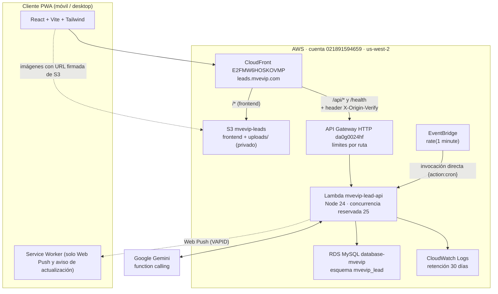

# MEMORIA TÉCNICA - MVEVIP LEAD REMINDER & ASISTENTE IA

**Proyecto:** MVEVIP Leads & Recordatorios (PWA)  
**Versión del frontend:** 1.0.8 (el backend no tiene número de versión; ver el historial de commits)  
**Dominio de producción:** [https://leads.mvevip.com](https://leads.mvevip.com)  
**Repositorios:**  
- Personal (respaldo y actividad): [https://github.com/caloloc2/mvevip_leads_agente](https://github.com/caloloc2/mvevip_leads_agente)  
- Empresa (colaborador principal): [https://github.com/mvevip/mvevip-leads-app](https://github.com/mvevip/mvevip-leads-app)  
  *El trabajo de las sesiones del 21 al 23-oct-2026 se hizo y se subió solo a este repositorio; el personal no se actualizó desde esas sesiones (sincronizarlo a mano si se usa de respaldo).*  
**Última actualización:** 23 de octubre de 2026

> Este documento describe el sistema **tal como está desplegado hoy**. El historial de cambios y los pendientes están al final (secciones 10 y 11). Los procedimientos de operación (logs, desbloqueos, rotación de secretos, reversiones) están en la sección 7.

---

## 0. Dónde estamos y cómo retomar (al 23-oct-2026)

**Estado actual**
- **Producción:** frontend **1.0.8** y backend con todo lo de la sesión de endurecimiento del 21-oct, Lambda en **Node 24**. `main` (commit `a2743fb`) refleja exactamente lo desplegado. No hay trabajo a medias ni ramas con cambios sin integrar.
- **Despliegue:** por GitHub Actions desde `main` (sección 8.5). Último despliegue: frontend 1.0.8 (run 6, 22-oct-2026). Backend desplegado con el flujo nuevo en el run 5.
- **Sonido de notificaciones:** se decidió **dejarlo como está** (ver 4.4). No hay cambios pendientes ahí.
- **En curso (23-oct-2026): integración con Chatrace, etapa 1** (ver 4.5). Desarrollada y probada, en un PR; **todavía sin desplegar** (frontend 1.0.9). Para ponerla en marcha hay pasos manuales tuyos (SQL y token): **7.9**. Hasta entonces la app en producción se comporta como siempre.

**Cómo se trabaja (flujo acordado)**
1. Se piden los cambios y se desarrollan en la rama de trabajo (`claude/awesome-goodall-olw275`, que se reinicia desde `main` en cada tanda).
2. Se prueban y se abre un PR a `main`; el **CI** debe quedar en verde.
3. Con la orden explícita «mergea y despliega» se mergea el PR y se lanza `Deploy` desde `main` (`target` = `frontend`, `backend` o ambos). Se verifica por fuera: `version.json`, `/health`, un login inválido por `leads.mvevip.com` (debe dar 401) y el respaldo en S3.
4. Para volver atrás: workflow `Rollback` (8.3).

**Reglas de trabajo**
- Todo cambio en IAM o en AWS que no sea el despliegue se confirma antes con el responsable. Mergear y desplegar requieren una orden explícita en cada ocasión.
- **Antes de reiniciar la rama de trabajo desde `main`, comprobar `git log origin/main..HEAD`:** si hay commits sin mergear, un push con `--force-with-lease` los borra de la rama remota (el 22-oct pasó con la actualización de la memoria técnica y hubo que recuperarla del repositorio local).
- El workflow `Deploy` no tiene aprobación manual: no se lanza sin orden.
- **Claude nunca ejecuta SQL ni maneja secretos.** Todo cambio en MySQL se entrega como scripts (cambio, verificación y reversión) que ejecuta el responsable; los tokens y claves (por ejemplo el de Chatrace) los carga el responsable en AWS con `deploy/set-lambda-env.ps1` y nunca se comparten en el chat ni en el repositorio.

**Comprobación rápida del estado**
```bash
curl -s https://leads.mvevip.com/version.json     # debe decir 1.0.8
curl -s https://leads.mvevip.com/health           # {"status":"ok",...}
```

**Próximos pasos sugeridos** (el detalle está en la sección 11.1)
1. Probar `Rollback` una vez con el respaldo más reciente (hoy sin probar).
2. Subir las acciones de GitHub que usan Node 20 y alinear los Dockerfiles locales a Node 24.
3. Iconos PNG de la PWA y de las notificaciones (hoy no existen).
4. Seguridad pendiente: RDS accesible públicamente, rol compartido con `AmazonS3FullAccess` y el hash del administrador en `database_setup.sql`.
5. **Chatrace (etapa 1, ya desarrollada):** ponerla en marcha con los pasos de 7.9 (verificar el id, SQL, token, desplegar, probar) y después la etapa 2 (etiquetas por intención desde el chat, 11.1 nº 16).
6. Ideas aplazadas: selector de tonos para el chime de la app, alertas por WhatsApp.

---

## 1. Resumen ejecutivo

MVEVIP Lead Reminder es una Aplicación Web Progresiva (PWA) para la fuerza comercial de MVEVIP. Centraliza la gestión de clientes potenciales (leads), citas y recordatorios, con notificaciones Web Push y un asistente conversacional impulsado por **Google Gemini** que consulta y modifica recordatorios mediante herramientas acotadas (function calling), por texto, voz o imágenes.

Hay 23 cuentas registradas. El pico observado de tráfico en la última semana fue de ~24 peticiones por minuto.

---

## 2. Arquitectura



**Flujo de una petición de la app:** el navegador llama a `https://leads.mvevip.com/api/...`; CloudFront reenvía al API Gateway agregando la cabecera secreta `X-Origin-Verify`; el API Gateway aplica los límites por ruta e invoca la Lambda; la Lambda verifica la cabecera, aplica los límites de intentos, autentica el JWT y responde.

**Modo local:** Docker Compose con puertos aislados (frontend `6410`, backend `6411`, MySQL `6412`).

---

## 3. Recursos en AWS

Todos los comandos usan el perfil de AWS CLI `marketingvip` y la región `us-west-2`.

| Recurso | Identificador | Detalle |
|---|---|---|
| **Dominio / certificado** | `leads.mvevip.com` | Certificado ACM `*.mvevip.com` (us-east-1), vence el **2027-02-13** |
| **CloudFront** | `E2FMW6HOSKOVMP` (`d372galked0u7s.cloudfront.net`) | Origen por defecto: S3 (OAC). `/api/*` y `/health` → API Gateway. Clase de precio 100. Sin WAF |
| **CloudFront Function** | `MarketingVIP-Router-us-west-2` | Compartida con otros proyectos (rutas `/pantalla`, `/admin`); reescribe rutas sin extensión a `/index.html` |
| **S3** | `mvevip-leads` | Acceso público bloqueado. Prefijos: `assets/`, `icons/`, `deployments/` (zips de la Lambda y `backup/`), `uploads/` (privado) |
| **API Gateway** | HTTP API `mvevip-lead-api-gw` (`da0g0024hf`) | Etapa `$default` con despliegue automático. Integración `qxqhxp8` (AWS_PROXY v2, 30 s) |
| **Lambda** | `mvevip-lead-api` | **Node.js 24.x** (desde el 21-oct-2026; antes 20.x) · 512 MB · 30 s · x86_64 · handler `lambda.handler` · sin VPC · **concurrencia reservada: 25** |
| **Rol de la Lambda** | `mvevip-api-leads-role-brclsbmj` | **Compartido** con la función `mvevip-api-leads` (otro sistema). Tiene `AmazonS3FullAccess` y la política inline `MvevipLeadApiLogs` |
| **Logs** | `/aws/lambda/mvevip-lead-api` | Retención de 30 días |
| **EventBridge** | regla `mvevip-lead-cron-rule` | `rate(1 minute)` → Lambda con `{"action":"cron"}` |
| **RDS** | `database-mvevip` (MySQL 8.4.8, `db.t4g.small`) | **Compartido con otros sistemas.** Esquema de esta app: `mvevip_lead`. Accesible públicamente (pendiente, ver sección 11) |
| **Usuario IAM** | `mvevip-leads-media-signer` | Solo `s3:GetObject` sobre `uploads/*`; sus claves firman las URLs de imágenes |
| **Proveedor OIDC** | `token.actions.githubusercontent.com` | Creado el 22-oct-2026 para que GitHub Actions obtenga credenciales temporales (sin claves guardadas) |
| **Rol de despliegue** | `mvevip-leads-github-deploy` | Lo asume solo el environment `production` de `mvevip/mvevip-leads-app`. Permisos mínimos: ver 8.5 |

### 3.1. API Gateway: rutas y límites

| Ruta | Límite sostenido | Ráfaga |
|---|---|---|
| `$default` (todas las demás) | 30 por segundo | 60 |
| `POST /api/auth/login` | 5 por segundo | 10 |
| `POST /api/bot/turn` | 3 por segundo | 6 |
| `POST /api/bot/conversation` | 3 por segundo | 6 |

Los límites son **globales por ruta** y de **mejor esfuerzo**: frenan bien la carga sostenida, pero una ráfaga simultánea puede pasar parcialmente. La barrera dura contra ráfagas es la **concurrencia reservada de 25** de la Lambda (el exceso recibe 503). Esta función comparte con unas 25 funciones más un límite de 1.000 ejecuciones simultáneas de la cuenta; la reserva evita que un abuso afecte a esos otros sistemas. El máximo real observado en 7 días fue de 4.

### 3.2. Variables de entorno de la Lambda

| Variable | Descripción |
|---|---|
| `DATABASE_URL` | Cadena de conexión a `mvevip_lead` en RDS |
| `JWT_SECRET` | **Obligatoria**: sin ella la app no arranca (no hay valor por defecto en el código) |
| `JWT_EXPIRES_IN` | Vigencia del token (`5d`) |
| `GEMINI_API_KEY` | Clave de Google Gemini |
| `VAPID_PUBLIC_KEY`, `VAPID_PRIVATE_KEY`, `VAPID_SUBJECT` | Claves y contacto para Web Push |
| `TZ` | `America/Guayaquil` |
| `NODE_ENV` | `production` |
| `S3_BUCKET_NAME` | `mvevip-leads` |
| `CLOUDFRONT_DOMAIN` | `leads.mvevip.com` (dominio con el que se guardan las URLs en la base) |
| `MEDIA_SIGNER_ACCESS_KEY_ID`, `MEDIA_SIGNER_SECRET_ACCESS_KEY` | Claves del usuario IAM `mvevip-leads-media-signer` |
| `ORIGIN_VERIFY_SECRET` | Secreto de la cabecera `X-Origin-Verify` (debe coincidir con CloudFront) |
| `ORIGIN_VERIFY_MODE` | `enforce` en producción (`off` \| `log` \| `enforce`) |

Opcionales (no definidas en producción): `ORIGIN_VERIFY_SECRET_PREVIOUS` (rotación), `CORS_ORIGINS` (por defecto `https://leads.mvevip.com,http://localhost:6410`), `CRON_SECRET` (habilita la ruta HTTP del cron; sin ella responde 404). `.env.example` documenta todas.

Integración con Chatrace (todas opcionales; **sin `CHATRACE_API_TOKEN` la integración queda apagada** y nada cambia): `CHATRACE_API_TOKEN` (secreto; se carga con `deploy/set-lambda-env.ps1`, ver 7.9), `CHATRACE_BASE_URL` (por defecto `https://api.chatrace.com`; permite apuntar a un servidor simulado en las pruebas), `CHATRACE_DEFAULT_COUNTRY` (código de país para teléfonos sin él, por defecto `593`) y `CHATRACE_TIMEOUT_MS` (tiempo máximo por llamada, por defecto `4000`).

> **Cuidado al editarlas:** `aws lambda update-function-configuration --environment` **reemplaza todas** las variables. Siempre se debe leer las actuales, combinar y escribir (ver 7.6). Nunca pegar valores secretos en chats o tickets.

---

## 4. Componentes del código

```
mvevip_lead_app/
├── client/                      # Frontend React + Vite PWA
│   ├── public/                  # sw.js, manifest.json, version.json, iconos
│   └── src/
│       ├── components/          # AssistantChatView, CalendarAgendaView, TimelineView, Header, modales...
│       ├── context/             # AuthContext, ThemeContext, UpdateContext
│       ├── pages/               # HomePage, LoginPage
│       └── services/            # api.js, pushService.js, soundService.js
├── server/                      # Backend Express (local) y handler de Lambda
│   ├── lambda.js                # Handler: distingue cron de EventBridge y peticiones HTTP
│   ├── prisma/                  # schema.prisma y seed.js
│   └── src/
│       ├── app.js               # Middlewares globales y manejo de errores
│       ├── server.js            # Servidor local (con node-cron)
│       ├── routes/api.js
│       ├── controllers/         # auth, reminder, bot, admin, push
│       ├── middleware/          # auth, originVerify, signMedia, cronAuth
│       ├── services/            # geminiService, cronScheduler, webPushService, s3Service
│       └── utils/               # logger, requestContext, clientIp, rateLimit, sessionVersion,
│                                # passwords, jwtConfig, prismaClient
└── deploy/
    ├── bucket-policy.json       # Política aplicada al bucket (OAC acotado + Deny a uploads/*)
    ├── cloudfront-config.json   # Configuración inicial de la distribución (referencia histórica)
    ├── database_setup.sql       # Esquema completo sincronizado con producción
    ├── migrations/              # Cambios posteriores, numerados
    ├── deploy-aws.ps1           # Despliegue de frontend y backend
    ├── package-lambda.ps1       # Empaquetado y verificación del zip de la Lambda
    └── eventbridge-targets.json
```

**Stack real:** React 19, Vite 6, Tailwind 4, Axios, date-fns, lucide-react · Node 24 en Lambda (los contenedores locales aún usan Node 20, ver 11.1), Express 4, Prisma 6.19 (MySQL), `@google/generative-ai` 0.24, `@codegenie/serverless-express`, `web-push`, `bcryptjs`, `jsonwebtoken`, `multer`, AWS SDK v3 (`client-s3`, `s3-request-presigner`). `node-cron` solo se usa en local; en producción el cron lo dispara EventBridge.

### 4.1. API

| Grupo | Rutas |
|---|---|
| Autenticación | `POST /api/auth/login`, `change-password`, `avatar`, `skip-first-login`; `GET /api/auth/profile` |
| Recordatorios | `GET/POST /api/reminders`; `GET /api/reminders/:id`; `PATCH :id/complete`, `reopen`, `dismiss`, `transfer`; `POST :id/followups` |
| Asistente | `GET/DELETE /api/bot/history`; `POST /api/bot/turn` (y `/api/bot/conversation`, alias) |
| Push | `GET /api/push/public-key`; `POST subscribe`, `unsubscribe`, `test` |
| Administración (solo ADMIN) | `GET/POST /api/admin/users`; `PATCH users/:id/role` (cambia ADMIN↔ASESOR); `PATCH users/:id/toggle-status`; `POST users/:id/reset-password`; `POST /api/admin/notifications`; `GET /api/admin/stats` |
| Cron | `GET /api/cron/check-reminders` (deshabilitada: 404 salvo que exista `CRON_SECRET`) |
| Salud | `GET /health` |

### 4.2. Asistente IA

- **Modelo:** `gemini-3.8-flash` (fijo en `geminiService.js`).
- **Herramientas (6), todas por Prisma, sin SQL libre:** `get_my_reminders`, `search_leads`, `get_lead_details`, `update_reminder`, `add_followup_note`, `create_reminder`. No existe ninguna herramienta de borrado: solo se puede descartar (`DISMISSED`) o completar.
- **Privacidad por rol:** un ASESOR solo accede a sus propios leads (filtro en el código). Un ADMIN ve por defecto solo los suyos y accede a otros asesores solo si lo pide explícitamente (esa parte depende del prompt, no del código).
- **Fechas:** los días se calculan siempre en hora de Quito (UTC-5 fijo), sin depender de la zona horaria del servidor.
- **Límites de tiempo:** timeout de 15 s por llamada a Gemini y presupuesto de 24 s por turno (el API Gateway corta a los 30 s). Un único reintento ante 429/503.
- **Rondas de herramientas:** hasta 3. Si el modelo sigue pidiendo herramientas o responde sin texto, se hace una llamada final **sin herramientas** pidiendo responder con lo ya obtenido. Nunca se entrega ni se guarda una respuesta vacía.
- **Bloqueos del filtro de contenido:** Gemini evalúa todo el contexto y da falsos positivos ocasionales (`PROHIBITED_CONTENT`). Si bloquea el primer llamado de un turno y hay historial, se reintenta una vez **sin historial**. Nunca se reintenta después de ejecutar herramientas (no se duplican escrituras). Los logs de error registran `blockReason`, `hasFile`, `fileType` (imagen o audio) e `historyMessages`.
- **Errores:** se clasifican (timeout, demanda alta, contenido bloqueado, respuesta vacía, genérico) y el usuario recibe un mensaje natural. El detalle técnico va solo a los logs. Los mensajes de error no se guardan en el historial.
- **Límite de uso:** 15 mensajes por minuto por usuario.
- **Historial:** se guarda en `chat_messages`; se omiten los mensajes vacíos al construir el contexto y al listarlos.

### 4.3. Frontend (resumen de funciones)

- **Estación de trabajo desktop (`lg ≥ 1024px`):** asistente a la izquierda y calendario/agenda a la derecha con scroll independiente. En móvil, `BottomNav` alterna entre Asistente y Agenda con gestos de deslizamiento.
- **Calendario y agenda:** `DayPicker` muestra la semana de lunes a domingo; `TimelineView` muestra franjas de 5 AM a 11 PM (agenda hasta las 12 AM, hora de Quito) y un bloque «Fuera de horario» (12–5 AM) que aparece solo si hay compromisos en ese tramo, para que ninguno quede oculto. El cron de notificaciones no tiene restricción de día ni hora: corre 24/7.
- **Cambio de tipo de usuario:** el panel de usuarios permite pasar un usuario de ADMIN a ASESOR y viceversa. Reglas: no se puede cambiar el propio tipo; no se puede degradar al último administrador activo; el cambio cierra las sesiones del usuario (`tokenVersion`) y le envía un aviso push; queda el log `role_changed` (actor, objetivo, de, a, sesiones cerradas). Los permisos los decide siempre el servidor según el rol en la base de datos.
- **Agenda multi-asesor:** los administradores filtran por uno, varios o todos los asesores; cada tarjeta muestra el asesor responsable.
- **Chat:** texto, notas de voz, fotos por selección, arrastrar y soltar, y pegado desde el portapapeles (`Ctrl + V`).
- **Notificaciones:** Web Push (VAPID) con sonido y vibración; compatible con iOS 16.4+ (PWA instalada) y Chrome en Android. Con la app abierta suena además un chime propio con volumen configurable en Perfil (ver 4.4).
- **Visual móvil:** `theme-color` dinámico (claro/oscuro) y áreas seguras para notch.
- **Actualizaciones:** `UpdateContext` consulta `/version.json` y avisa de versiones nuevas.
- **Service Worker:** solo gestiona Web Push, el aviso de actualización y la limpieza de cachés antiguas. **No tiene manejador `fetch`: la app no funciona sin conexión.**

### 4.4. Notificaciones y sonido

| Situación | Quién pone el sonido | ¿Se puede cambiar? |
|---|---|---|
| **App abierta** (chime de la app) | La app (`client/src/services/soundService.js`) | Sí: tono, duración y volumen |
| **App cerrada o en segundo plano** (notificación push) | El sistema operativo del dispositivo | **No desde la app** |

**Con la app cerrada** el estándar de notificaciones web no permite elegir el tono ni el volumen (la opción `sound` de la propuesta original nunca se implementó en los navegadores). Lo decide el dispositivo: en **Android** cada sitio tiene su propia categoría de notificación y ahí se elige el tono; en **iPhone** una web app usa el sonido por defecto y no se puede cambiar; en **computador**, el sonido de notificaciones del sistema. La vibración (`[200,100,200,100,200]` en `sw.js`) solo la respeta Android; iOS la ignora en notificaciones web. Guía para los dispositivos: 7.8.

**Con la app abierta (1.0.8, 22-oct-2026):**
- `scheduleChime()` genera tres notas (D5, A5, D6) con un limitador y después el volumen del usuario (0 a 100 %, **100 % por defecto**), de modo que el control es proporcional en todo el rango.
- El volumen se guarda por dispositivo en `localStorage` (`mvevip_sound_volume`; el interruptor, en `mvevip_sound_enabled`). El control está en **Perfil**, bajo el interruptor de sonido, y se oculta si el sonido está apagado; al soltarlo suena una muestra.
- El tono de una push llega por un mensaje del Service Worker (`PUSH_NOTIFICATION_RECEIVED`) que escucha `HomePage.jsx`. Como no nace de un toque del usuario, el audio se prepara en el **primer gesto** (los navegadores móviles, sobre todo iOS, lo exigen).
- Medición (renderizado offline en Chromium, dB respecto al máximo digital): antes pico -9,9 / promedio -28,7; ahora al 100 % pico -1,5 / promedio -15,5 (≈ 13 dB más fuerte); al 25 % ≈ el volumen anterior. **No se ha probado en un teléfono real** (ni en iOS).
- Con la app abierta suenan dos cosas a la vez: el chime de la app y el sonido de la notificación del sistema. Es el comportamiento esperado.

**Decisión (23-oct-2026):** se mantiene esta configuración sin cambios. Opciones evaluadas y aplazadas: (1) selector de 3 o 4 tonos para el chime de la app, un cambio pequeño; (2) cada asesor elige su tono en Android; (3) app nativa con Capacitor para tener sonido propio también con la app cerrada y en iPhone (descartada por ahora: cuentas de desarrollador, revisión de las tiendas, FCM/APNs en lugar de Web Push y dos apps que mantener); (4) alertas por WhatsApp (ya en el roadmap), con el sonido que cada persona tenga en WhatsApp.

### 4.5. Integración con Chatrace (etapa 1)

*Estado al 23-oct-2026: desarrollada y probada, en un PR; sin desplegar. Puesta en marcha: 7.9.*

**Qué hace.** Al crear un recordatorio desde el chat (herramienta `create_reminder`, `geminiService.js`), el cliente queda en Chatrace (`https://api.chatrace.com`, documentación Swagger en `/swagger/`): si el contacto ya existe se le agregan las etiquetas; si no existe se crea con sus datos y las mismas etiquetas.

**Cómo identifica al contacto.** Según indicó el responsable, el id de un contacto en Chatrace es su **teléfono con código de país, solo dígitos** (`593991234567`), tanto para buscarlo (`GET /contacts/{id}`) como al crearlo. `normalizePhone` (`chatraceService.js`) convierte lo que escriba el asesor (`0991234567`, `+593 99 123 4567`, `991234567`…) a ese formato y, si no lo reconoce, **no adivina**: se omite la sincronización. *La confirmación del formato con el token real está pendiente (7.9, paso 0).*

**Flujo.** `GET /contacts/{id}`: si existe, agrega cada etiqueta con `POST /contacts/{id}/tags/{tag_id}` (los ids se resuelven por nombre con `GET /accounts/tags/name/{nombre}` y se guardan 10 minutos en memoria); si responde 404, `POST /contacts` con `phone` (`+dígitos`), `first_name`, `last_name` y acciones `add_tag` por nombre.

**Etiquetas.** La **fija** (`app_settings` clave `chatrace.fixed_tag`) más la del **asesor asignado** (`chatrace.advisor_tag.<userId>`). Las configuran los administradores en la app: la fija en **Perfil → Integración Chatrace** y la de cada asesor en **Gestionar Usuarios & Asesores**. En ambos sitios se elige una etiqueta existente de Chatrace o se crea una nueva; una etiqueta que no existe **solo se crea si el administrador lo pide expresamente**.

**Aislamiento: el lead y el recordatorio funcionan igual que siempre.**
- `syncReminderContact` (`chatraceSync.js`) **nunca lanza**: cualquier fallo se registra en logs y se devuelve como resultado. El recordatorio ya está creado cuando se llama; la respuesta del chat es la de siempre más un aviso.
- Sin `CHATRACE_API_TOKEN` el resultado de `create_reminder` es **idéntico** al de antes de existir la integración.
- Tope de 4 s para toda la sincronización, y se omite si al turno (24 s) le quedan menos de 6 s. Un solo reintento ante 429 o 5xx. Sin reintentos automáticos posteriores.
- Los errores propios solo tienen el tipo (`auth`, `timeout`, `network`, `rate_limited`, `server`, `bad_request`) y el estado HTTP; **nunca teléfono, nombre, token ni el cuerpo de la respuesta**. El resultado (`result.chatrace`: `status`, `reason`, `created`, `message`) viaja al modelo, a `ChatMessage.metadata` y a la pantalla sin datos del cliente.
- Si la tabla `app_settings` aún no existe, el recordatorio se crea y se sincroniza sin etiquetas.

**En el chat.** El asistente menciona el resultado en una frase (instrucción en `SYSTEM_PROMPT`) y la pantalla agrega un aviso junto a «Nuevo lead creado» («Contacto nuevo en Chatrace», «Etiquetado en Chatrace», «Sin teléfono: no se sincronizó», «No se pudo sincronizar con Chatrace»…). Igual que «Nuevo lead creado», solo se ve en los mensajes en vivo: el historial recargado guarda `metadata` y no muestra los avisos.

**Código.** Backend: `server/src/services/chatraceService.js` (cliente HTTP, `normalizePhone`, etiquetas, `syncContact`), `chatraceSettings.js` (lectura y escritura de `app_settings`), `chatraceSync.js` (coordina un recordatorio y nunca lanza); endpoints de administración (`adminController.js`): `GET /api/admin/chatrace/status`, `GET /api/admin/chatrace/tags`, `PUT /api/admin/chatrace/fixed-tag` y `PUT /api/admin/users/:id/chatrace-tag`; `GET /api/admin/users` incluye `chatraceTag`. Frontend: `ChatraceTagPicker.jsx` (selector reutilizable y hook `useChatraceTags`), `ChatraceIntegrationPanel.jsx` (Perfil), el modal de usuarios y `AssistantChatView.jsx`.

**Fuera de alcance por ahora:** etiquetas por *intención* desde el chat (etapa 2, ver 11.1), sincronizar al reagendar, transferir o cerrar un recordatorio, la API REST `POST /reminders`, reintentos automáticos con estado por recordatorio y cualquier otra función de Chatrace (mensajes, flujos, pipelines, citas). `chatraceService.js` queda reutilizable para ellas.

**Privacidad.** El nombre y el teléfono del cliente viajan a Chatrace (hoy ya viajan a Google Gemini).

---

## 5. Base de datos

Esquema `mvevip_lead` (MySQL 8.4, `utf8mb4_unicode_ci`). Script completo: `deploy/database_setup.sql`. El esquema **no usa migraciones de Prisma** (no existe `_prisma_migrations`): los cambios se aplican con scripts SQL numerados en `deploy/migrations/`, ejecutados a mano.

| Tabla | Contenido |
|---|---|
| `users` | Cuentas (ADMIN / ASESOR). Incluye `isActive`, `mustChangePassword`, `isFirstLogin` y `tokenVersion` (versión de sesión) |
| `reminders` | Recordatorios y leads, con estado, prioridad, origen y `notificationSent` |
| `reminder_followups` | Bitácora de cada recordatorio |
| `reminder_tags`, `tags` | Etiquetas (hoy sin endpoints en el API) |
| `push_subscriptions` | Suscripciones Web Push por dispositivo |
| `chat_messages` | Historial del asistente por usuario |
| `rate_limit_events` | Contadores de los límites de intentos (claves en hash SHA-256; se purgan los de más de 24 h cada hora) |
| `app_settings` | Configuración clave/valor de la app. Hoy: etiquetas de Chatrace (`chatrace.fixed_tag`, `chatrace.advisor_tag.<userId>`). Quitar una etiqueta guarda una cadena vacía (no se borran filas). **Migración 002, pendiente de ejecutar** |

**Migraciones aplicadas:** `001_rate_limit_and_token_version.sql` (21-oct-2026). **Pendiente de ejecutar:** `002_chatrace.sql` (solo crea la tabla `app_settings`, es idempotente y no toca ninguna tabla existente), con `002_chatrace_verify.sql` (solo lectura) y `002_chatrace_rollback.sql`. **Las ejecuta el responsable, antes de desplegar.**

> Los objetos nuevos se consultan con SQL directo (`$queryRaw`) y con tolerancia a fallos, sin depender del cliente de Prisma generado. `schema.prisma` los documenta; el próximo `prisma generate` los incluirá.

---

## 6. Seguridad

| Capa | Medida |
|---|---|
| **Acceso directo al API Gateway** | La Lambda exige la cabecera secreta `X-Origin-Verify` que CloudFront agrega a cada petición (`ORIGIN_VERIFY_MODE=enforce`). Una llamada directa recibe 403. Se compara en tiempo constante y soporta rotación sin interrupción |
| **Autenticación** | JWT de 5 días. `JWT_SECRET` obligatorio. Contraseña de 8 a 72 caracteres; las temporales las genera `crypto` (formato `MVEVIP` + 8 caracteres sin ambiguos) |
| **Fuerza bruta** | Máximo 5 intentos fallidos en 15 min por correo + IP y 50 por IP. 429 con `Retry-After`. Contador compartido en la base de datos. Comparación bcrypt de relleno si el correo no existe; la cuenta deshabilitada solo se informa con la contraseña correcta |
| **IP del usuario** | Se usa `requestContext.http.sourceIp` del API Gateway. `X-Forwarded-For` y `CloudFront-Viewer-Address` **no son confiables** (se pueden falsificar llamando directo) |
| **Sesiones revocables** | `users.tokenVersion` va en el JWT. El reseteo de contraseña desde el panel admin lo incrementa e invalida los tokens anteriores en ≤ 30 s. Los tokens anteriores a la función valen como versión 0 |
| **Asistente** | Límite de 15 mensajes por minuto por usuario; sin herramientas de borrado; errores sin detalle técnico |
| **Archivos subidos** | Fotos de clientes y avatares **privados**: URLs firmadas de S3 (ver 6.1) |
| **Red** | CORS restringido a `https://leads.mvevip.com` y `http://localhost:6410`; límites por ruta en el API Gateway; concurrencia reservada |
| **Respuestas** | `X-Content-Type-Options: nosniff`, `Referrer-Policy: no-referrer`, `Cache-Control: no-store`; sin `X-Powered-By`; errores 4xx/5xx sin detalle interno y con `requestId` |
| **Tamaños** | JSON de 100 KB por defecto; hasta 6 MB solo en avatar, cambio de contraseña y alta de usuarios |
| **Cron HTTP** | Ruta deshabilitada salvo que exista `CRON_SECRET` |
| **Secretos** | Ningún `.env` ni secreto se versiona. Se guardan solo en variables de la Lambda y en CloudFront (el secreto de origen) |

### 6.1. Archivos subidos (`uploads/`)

- **Almacenamiento:** `s3://mvevip-leads/uploads/{chat-images|avatars}/<uuid>.<ext>` (nombres no adivinables). La base de datos guarda la URL canónica `https://leads.mvevip.com/uploads/...`.
- **Entrega:** un middleware reemplaza, en todas las respuestas JSON, los campos `avatarUrl`, `mediaUrl` e `images` por una URL firmada de S3 con vigencia de **24 a 25 horas**. La fecha de firma se redondea a la hora para que la URL sea estable y cacheable.
- **Acceso:** la política del bucket (`deploy/bucket-policy.json`) permite a CloudFront leer el bucket solo desde la distribución `E2FMW6HOSKOVMP` y **le deniega `uploads/*`**. Sin una URL firmada vigente no se puede ver ninguna foto.
- **Claves de firma:** del usuario IAM `mvevip-leads-media-signer` (solo lectura de `uploads/*`). Si faltan, se firma con el rol de la Lambda y las URLs duran menos (hasta que expiren sus credenciales temporales).
- **Al guardar:** si el cliente reenvía una URL firmada como avatar, se guarda sin firma.
- **Limitación:** una pestaña abierta más de un día mostrará las fotos del chat rotas hasta recargar.

---

## 7. Operación

### 7.1. Logs y búsquedas útiles
Los logs son líneas JSON en `/aws/lambda/mvevip-lead-api`.

```powershell
# Seguir los logs en vivo
aws logs tail /aws/lambda/mvevip-lead-api --since 30m --follow --region us-west-2 --profile marketingvip

# Solo errores
aws logs filter-log-events --log-group-name /aws/lambda/mvevip-lead-api --start-time <epoch_ms> --filter-pattern '"\"level\":\"error\""' --region us-west-2 --profile marketingvip
```

| `stage` | Significado |
|---|---|
| `http` | Error HTTP (4xx en `warn`, 5xx en `error`) con `requestId` |
| `assistant_turn` | Un turno del asistente: duración, llamadas a Gemini, `forcedAnswer`, herramientas y parámetros no sensibles |
| `tool:<nombre>`, `gemini_retry`, `gemini_not_configured` | Fallos de herramientas o de Gemini |
| `gemini_blocked_retry` | Gemini bloqueó el primer llamado de un turno y se reintentó sin historial (incluye `blockReason` e `historyMessages`) |
| `push_delivery_failed`, `push_send`, `push_broadcast` | Envíos push fallidos por dispositivo (`statusCode`, si la suscripción se eliminó) o error general; nunca incluyen el endpoint ni el contenido |
| `bot_turn` | Fallo del controlador del asistente |
| `login_failed`, `login_rate_limited` | Seguridad del login (incluyen la IP) |
| `rate_limit_*`, `token_version_*` | Fallos de las tablas del limitador o de `tokenVersion` (el sistema sigue funcionando sin límite) |
| `origin_verify_failed` | Petición sin la cabecera de origen válida (en `enforce` se rechaza con 403) |
| `sign_media` | Fallo al firmar una URL (se responde sin firmar) |
| `chatrace_sync` | Resultado de sincronizar un recordatorio con Chatrace: `reminderId`, `userId`, `status`, `reason`, `created`, etiquetas aplicadas y fallidas, `durationMs`. Nunca teléfono ni nombre |
| `chatrace_sync_failed` | Fallo hablando con Chatrace: solo `kind` (`auth`, `timeout`, `network`, `rate_limited`, `server`, `bad_request`, `unexpected`) y el estado HTTP |
| `chatrace_config`, `chatrace_admin_*` | Configuración de etiquetas (quién la cambió) o lectura de `app_settings` no disponible (¿falta la migración 002?) |

Si un usuario reporta un error, el `requestId` que recibió en la respuesta 500 coincide con el `RequestId` del log.

### 7.2. Desbloquear un login
Esperar 15 minutos, o ejecutar `DELETE FROM rate_limit_events;` en `mvevip_lead` (borra todos los contadores).

### 7.3. Cerrar las sesiones de un usuario
Resetear su contraseña desde el panel de administración (incrementa `tokenVersion`). Desactivar la cuenta también la bloquea en la siguiente petición.

### 7.4. Modos de la verificación de origen
`enforce` rechaza el acceso directo. Si CloudFront dejara de enviar la cabecera y la app dejara de funcionar, se pasa `ORIGIN_VERIFY_MODE` a `log` (registra sin bloquear) o `off` con el procedimiento de 7.6; no requiere redeploy.

### 7.5. Rotar el secreto de origen (sin interrupción)
1. En la Lambda: `ORIGIN_VERIFY_SECRET_PREVIOUS` = secreto actual y `ORIGIN_VERIFY_SECRET` = secreto nuevo.
2. CloudFront → Origins → `ApiGatewayOrigin` → Edit → cambiar el valor de `X-Origin-Verify` por el nuevo. Esperar el estado **Deployed**.
3. Verificar en los logs que no hay `origin_verify_failed` del tráfico de la app.
4. Quitar `ORIGIN_VERIFY_SECRET_PREVIOUS`.

El secreto se genera en la máquina del operador y no debe pasar por chats ni tickets.

### 7.6. Editar variables de entorno de la Lambda (sin perder las demás)
```powershell
$cfg = aws lambda get-function-configuration --function-name mvevip-lead-api --region us-west-2 --profile marketingvip | ConvertFrom-Json
$vars = @{}
$cfg.Environment.Variables.PSObject.Properties | ForEach-Object { $vars[$_.Name] = $_.Value }
"Variables actuales: $($vars.Count)"      # verificar el total antes de seguir

$vars["ORIGIN_VERIFY_MODE"] = "log"       # ejemplo: la variable a cambiar

$json = @{ Variables = $vars } | ConvertTo-Json -Depth 5
[System.IO.File]::WriteAllText("$PWD\lambda-env.json", $json, (New-Object System.Text.UTF8Encoding $false))
aws lambda update-function-configuration --function-name mvevip-lead-api --environment file://lambda-env.json --region us-west-2 --profile marketingvip --query "[LastUpdateStatus,length(Environment.Variables)]" --output text
Remove-Item lambda-env.json                # el archivo contiene todos los secretos
```

### 7.7. Invalidar la caché de CloudFront
```powershell
aws cloudfront create-invalidation --distribution-id E2FMW6HOSKOVMP --paths "/uploads/*" --profile marketingvip
```
CloudFront guarda en caché 24 h por defecto; tras cambiar permisos de `uploads/`, invalidar.

### 7.8. Guía para dispositivos: sonido de las notificaciones con la app cerrada
Los nombres de los menús varían según la marca y la versión del sistema. Desde las sesiones de Claude no se verificaron en dispositivos reales.

- **Android (Chrome):** mantener pulsado el icono de la app → Información de la app → Notificaciones → categoría del sitio `leads.mvevip.com` → importancia **Alta** o **Urgente** (emite sonido y aparece en pantalla) y, si se quiere, elegir el **Sonido**. Subir el volumen de notificaciones, desactivar No molestar y, en Batería, poner Chrome o la app **Sin restricciones** para que las notificaciones lleguen con la pantalla apagada.
- **iPhone (iOS 16.4 o superior, app agregada a la pantalla de inicio):** Ajustes → Notificaciones → la app → activar Permitir notificaciones y **Sonidos**; subir el volumen en Ajustes → Sonidos y vibración → Tono y alertas; comprobar que el **interruptor lateral de silencio** no esté en silencio y que Concentración / No molestar no bloquee la app.
- **Windows (Chrome o Edge):** Configuración → Sistema → Notificaciones → Chrome o Edge → activado y «Reproducir un sonido cuando llegue una notificación»; desactivar el Asistente de concentración. En el navegador, `chrome://settings/content/notifications` con `leads.mvevip.com` en Permitido.
- **macOS:** Ajustes del Sistema → Notificaciones → Google Chrome → estilo Alertas y «Reproducir sonido para notificaciones».
- **Probar:** en Perfil pulsar «Probar Push» y de inmediato bloquear el teléfono o cambiar de app.
- **Actualizar la app a la última versión:** Perfil → Versión de la App → «Buscar / Probar».

### 7.9. Puesta en marcha y operación de la integración con Chatrace
Orden obligatorio. Los pasos 1 y 2 los ejecuta el responsable (Claude no ejecuta SQL ni maneja secretos).

0. **Verificar el formato del id (una vez, con el token en tu terminal, sin compartirlo):** `GET https://api.chatrace.com/accounts/tags` (cabecera `X-ACCESS-TOKEN`) debe listar las etiquetas, y `GET /contacts/593XXXXXXXXX` de un contacto que ya exista debe responder 200 (404 si no existe). Si el id no fuera el teléfono en dígitos con código de país, hay que ajustar `normalizePhone`.
1. **SQL:** ejecutar `deploy/migrations/002_chatrace.sql` contra `mvevip_lead` con un usuario con permiso `CREATE` y después `002_chatrace_verify.sql` (debe mostrar la tabla `app_settings`). Es idempotente.
2. **Token:** `.\deploy\set-lambda-env.ps1 -DryRun` (simula, no cambia nada) y luego `.\deploy\set-lambda-env.ps1` (pide el token con entrada oculta; conserva las demás variables y solo muestra nombres). *El script no se pudo ejecutar en un PowerShell real durante su desarrollo: probar siempre primero con `-DryRun`.*
3. **Desplegar:** `Deploy` del backend y luego del frontend (1.0.9).
4. **Configurar en la app (administrador):** Perfil → Integración Chatrace debe decir **Conectada**; elegir o crear la etiqueta fija; en Gestionar Usuarios & Asesores elegir la etiqueta de cada asesor.
5. **Probar con un número propio:** crear un recordatorio desde el chat con ese teléfono (el chat muestra «Contacto nuevo en Chatrace» y en Chatrace aparece con las etiquetas); repetirlo (no se duplica); uno sin teléfono (avisa y se crea); revisar en los logs `chatrace_sync` y que `Errors` y `Throttles` de la Lambda sigan en 0.

**Apagar la integración al instante** (sin redesplegar): `.\deploy\set-lambda-env.ps1 -Remove`. Los recordatorios siguen funcionando igual; el Perfil mostrará «No activada».
**Revertir por completo:** `Rollback` del backend y, si se quiere, `002_chatrace_rollback.sql` (borra solo `app_settings` y la configuración de etiquetas).

---

## 8. Despliegue

### 8.1. Procedimiento oficial: GitHub Actions
Desde el 22-oct-2026 el despliegue oficial es el workflow **Deploy** (ver 8.5): se lanza desde `main`, con `target` = `backend`, `frontend` o `backend+frontend`. Los scripts de PowerShell siguientes quedan como **alternativa manual** (siguen funcionando, pero no hacen respaldo ni verificación automáticos).

```powershell
.\deploy\deploy-aws.ps1 -DeployBackend     # backend (Lambda) + frontend (S3) + invalidación de CloudFront
.\deploy\deploy-aws.ps1                    # solo frontend
```
`package-lambda.ps1`:
1. Ejecuta `npm install` dentro del contenedor `mvevip_lead_server`.
2. Genera el cliente de Prisma para `rhel-openssl-3.0.x`.
3. Empaqueta en `deploy/lambda-backend.zip`.
4. **Verifica el contenido del zip:** exige `lambda.js`, `src/app.js`, el motor de Prisma y **cada dependencia de `package.json`**. Si falta algo, descarta el zip y aborta.

> **Por qué el `npm install` y la verificación:** el contenedor monta `/app/node_modules` como volumen anónimo, por lo que una dependencia nueva de `package.json` no aparece ahí hasta instalarla (reconstruir la imagen no renueva ese volumen). Sin esos pasos, el zip salía sin la dependencia y la Lambda **fallaba al arrancar**. Esto ocurriría con `@aws-sdk/s3-request-presigner`, que se agregó el 21-oct-2026.

### 8.2. Antes y después de desplegar el backend
> Con el workflow **Deploy** el respaldo y la verificación son automáticos (ver 8.5). Lo siguiente aplica al despliegue manual.

- **Antes:** copiar el zip actual como respaldo: `aws s3 cp s3://mvevip-leads/deployments/lambda-backend.zip s3://mvevip-leads/deployments/backup/lambda-backend-<fecha>-<motivo>.zip`. Hoy hay 8 respaldos en `deployments/backup/`.
- **Después:** comprobar `GET /health`, que no haya errores en los logs, que el cron siga corriendo (`Invocación por EventBridge` cada minuto) y que `Errors` y `Throttles` de la Lambda estén en 0.
- **Cambios de esquema:** ejecutar primero el script SQL (los scripts son compatibles con el código anterior) y después desplegar.

### 8.3. Revertir
**Con GitHub Actions:** workflow **Rollback**. Sin parámetros lista los respaldos disponibles; con `backup_key` (nombre del zip en `deployments/backup/`) revierte la Lambda, deja `lambda-backend.zip` igual al revertido y verifica hash, `/health` y logs. *Todavía no se ha ejecutado de verdad (ver 11.1).* Manualmente:
```powershell
aws lambda update-function-code --function-name mvevip-lead-api --s3-bucket mvevip-leads --s3-key deployments/backup/<zip-de-respaldo>.zip --region us-west-2 --profile marketingvip
```
Verificar con `get-function-configuration` que `LastUpdateStatus` sea `Successful` y que el `CodeSha256` cambió.

### 8.4. Frontend
`deploy-aws.ps1` compila con Vite dentro del contenedor (el `client/package-lock.json` fija las versiones; tras traer cambios de dependencias ejecutar `docker exec mvevip_lead_client npm install`, no `npm ci`, porque `node_modules` es un volumen anónimo), sincroniza a S3 (con `no-cache` en `index.html`, `sw.js` y `version.json`) e invalida CloudFront. Al publicar una versión nueva se debe actualizar a la vez `client/src/version.js`, `client/public/version.json` y `CACHE_NAME` en `client/public/sw.js`.

### 8.5. GitHub Actions
Archivos: `.github/workflows/ci.yml`, `deploy.yml` y `rollback.yml`; scripts en `deploy/ci/` (`package-lambda.sh`, `verify-deploy.sh`); políticas IAM en `deploy/iam/`.

**Uso diario:** se piden y prueban los cambios, se mergean a `main` por PR (con el CI en verde) y se lanza `Deploy` desde `main`. Claude puede lanzarlo con sus herramientas de GitHub cuando se le pide «despliega»; **no hay aprobación manual** (el environment no tiene revisores), así que solo se lanza por orden explícita.

| Workflow | Cuándo corre | Qué hace |
|---|---|---|
| **CI** | Cada PR y cada push a `main` | `npm ci` (Node 24), `prisma generate`, sintaxis de todo el backend, la app carga, empaquetado Lambda verificado (17 elementos), build del cliente y coherencia de versiones (`version.js` = `version.json` = `sw.js`) |
| **Deploy** | Manual, solo desde `main` | `build`: empaqueta/compila. `deploy`: asume el rol por OIDC, respalda lo que hay en producción, sube y actualiza (Lambda y/o S3 + invalidación de CloudFront) y verifica (hash `CodeSha256`, `/health`, logs, versión publicada) |
| **Rollback** | Manual | Lista los respaldos o revierte la Lambda a uno (ver 8.3) |

**Respaldos automáticos:** `deployments/backup/lambda-backend-<AAAAMMDD-HHMMSS>-<sha>.zip` (backend) y `deployments/backup/frontend-<AAAAMMDD-HHMMSS>/` (frontend).

**Configuración (hecha el 22-oct-2026):**
- **AWS:** proveedor OIDC y rol `mvevip-leads-github-deploy` (`deploy/iam/github-deploy-trust.json` y `github-deploy-policy.json`, política inline `GithubDeploy`). El rol solo puede: actualizar el código de `mvevip-lead-api`, leer/escribir el bucket `mvevip-leads` **excepto `uploads/*`**, invalidar `E2FMW6HOSKOVMP` y leer los logs de la Lambda. No puede cambiar la configuración de la Lambda, tocar IAM/RDS ni otras funciones (probado con el simulador de IAM).
- **GitHub:** environment `production` sin revisores (los despliegues corren sin pausa; recomendado: restringir *Deployment branches* a `main`, no verificado desde aquí); variables `AWS_DEPLOY_ROLE_ARN` y `VITE_VAPID_PUBLIC_KEY` (clave pública VAPID; `build` y `deploy` declaran el environment para poder leerlas).

**Estado de las pruebas (22-oct-2026):** `Deploy` con `target=frontend` (run 3), con `target=backend` (run 5) y con `target=frontend` otra vez para la 1.0.8 (run 6) pasaron completos y se comprobaron por fuera (`version.json`, `/health`, login por CloudFront, respaldo en S3, contenido del bundle). Hubo dos intentos previos fallidos que no tocaron producción (runs 1, 2 y 4: variables del environment, formato del `sub` y permiso de etiquetas). **`Rollback` aún no se ha ejecutado de verdad.**

**Lecciones aprendidas (errores que ya se corrigieron):**
1. **Variables del environment:** una variable definida en el environment solo la ven los jobs que declaran `environment: production`; `build` la recibía vacía (PR 2).
2. **Formato del `sub` de OIDC:** GitHub emite hoy `repo:mvevip@344858672/mvevip-leads-app@1428663966:environment:production` (con IDs inmutables), no el clásico `repo:mvevip/mvevip-leads-app:environment:production`. La confianza del rol acepta ambos. Si falla con `Not authorized to perform sts:AssumeRoleWithWebIdentity`, buscar el evento en CloudTrail (`AssumeRoleWithWebIdentity`, región `us-west-2`) y comparar `userName` con la condición `sub`.
3. **Copias S3 a S3:** `aws s3 cp` consulta las etiquetas y exige `s3:GetObjectTagging`; se usa `--copy-props none` para no ampliar los permisos del rol.
4. **Lockfile:** `server/package-lock.json` carecía de `fsevents`, lo que rechaza `npm ci` con npm 11 (Node 24); se regeneró sin cambiar versiones.
5. **Fallos de autenticación lentos:** `configure-aws-credentials` reintenta cerca de 3 minutos antes de rendirse.
6. **CloudTrail** tarda unos minutos en mostrar eventos: la prueba principal de un despliegue es el hash de la Lambda que verifica el propio workflow.

**Cambios de esquema SQL:** el workflow no ejecuta SQL; los scripts de `deploy/migrations/` se siguen ejecutando a mano **antes** de desplegar (son compatibles con el código anterior).

---

## 9. Pruebas

Desde el 23-oct-2026 existe una primera suite en `server/test/` (`npm test`, que usa `node --test` sin dependencias nuevas y corre en el CI). Cubre **solo la integración con Chatrace** (74 pruebas): `normalizePhone`, el cliente HTTP contra un servidor simulado (contacto existente y nuevo, 401, 429, 5xx, timeout, red caída, token ausente, teléfono inválido), `create_reminder` con Prisma falso (Chatrace caído o lento, sin teléfono, sin tiempo en el turno, sin token → respuesta idéntica a la de antes) y los endpoints de administración. Comprueban además que ni los logs ni el resultado filtran teléfono, nombre ni token. Nunca llaman a la API real.

El resto del sistema sigue **sin pruebas automatizadas**: hasta ahora se validó con pruebas locales descartables (Express, bcrypt y JWT reales, con Prisma, S3 y Gemini simulados) y con comprobaciones en producción mediante logs y métricas de CloudWatch. Ampliar la suite es el pendiente nº 10 (11.1).

---

## 10. Historial de cambios

### Versiones del frontend
- **1.0.8 (22-oct-2026):** volumen configurable del tono con la app abierta (control en Perfil, se guarda en el dispositivo), chime de tres notas más fuerte con limitador y audio preparado en el primer toque del usuario. Con la app cerrada el sonido y su volumen los pone el sistema operativo, no la app.
- **1.0.7 (21-oct-2026):** calendario de lunes a domingo, de 5 AM a 12 AM, con bloque «Fuera de horario»; cambio de tipo de usuario (Administrador/Asesor) en el panel de usuarios; `package-lock.json` del cliente.
- **1.0.6 (12-oct-2026):** asistente a la izquierda y calendario a la derecha en desktop.
- **1.0.5 (12-oct-2026):** estación de trabajo desktop, sonido y vibración en push, arrastrar y soltar y pegado de imágenes en el chat.
- **1.0.4 y anteriores:** asistente con Gemini, agenda multi-asesor, ajustes móviles, resolución del bucle de actualización de la PWA.

### Sesión de endurecimiento del 21-oct-2026 (backend y AWS)
| Commit | Cambio |
|---|---|
| `490aad5` | Notificaciones push: reclamo atómico (sin envíos dobles) y reintento durante 15 minutos |
| `c61f112` | Errores: logs estructurados, mensajes seguros, timeouts de Gemini, 4xx correctos |
| `4963b97` | URLs firmadas para fotos y avatares; nombres UUID |
| `17d6ebf` | Política del bucket con `uploads/` privado y `.env.example` |
| `09310e1` / `9dfed1a` | Límite de intentos, sesiones revocables, CORS, cabeceras, tamaños, contraseñas; corrección de la IP detectada |
| `be72b84` / `006f9a5` | Verificación de origen CloudFront → API Gateway |
| `8cc1f94` | Asistente sin respuestas vacías, fechas en hora de Quito, historial sin mensajes vacíos |
| `25db1c2` / `90a9582` | Documentación; el empaquetado de la Lambda verifica el contenido del zip; revisión de compatibilidad con Node 22/24 |

| `61473c3` | Reintento sin historial ante bloqueos del filtro de Gemini; logs de diagnóstico del asistente y de push por dispositivo |
| `07ece8e` | Frontend 1.0.7: calendario de lunes a domingo (5 AM a 12 AM); endpoint `PATCH /api/admin/users/:id/role` y botón de cambio de tipo de usuario; `client/package-lock.json` |

**Runtime:** la Lambda pasó de `nodejs20.x` a `nodejs24.x` (cambio solo de configuración, sin redeploy de código).

**Despliegue de la 1.0.7 (21-oct-2026, 22:35 UTC):** backend por parche del zip (solo `adminController.js` y `api.js`; respaldo en `deployments/backup/lambda-backend-2026-10-21-pre-roles.zip`) y frontend compilado con Node 24 (idéntico byte a byte al compilado con Node 20) y subido a S3 con `no-cache` en `index.html`, `sw.js` y `version.json`; respaldo de los archivos anteriores en `deployments/backup/frontend-2026-10-21/`. El bundle se compila con `VITE_VAPID_PUBLIC_KEY` (la clave pública de la Lambda): el repo no la incluye (`client/.env.production` solo tiene `VITE_API_URL`), así que cualquier compilación fuera del contenedor debe definirla. Verificado: hash de la Lambda, `/health`, 0 errores, cron activo, `version.json` 1.0.7 y login sin errores de consola. Esos cambios se integraron a `main` el 22-oct-2026 (PR 1, commit `8ddb480`).

**Cambios en AWS y en la base de datos:** log group con retención de 30 días y permiso de logs en el rol; usuario IAM `mvevip-leads-media-signer`; variables de entorno nuevas; política del bucket con `Deny` a `uploads/*`; invalidación de `/uploads/*`; header `X-Origin-Verify` en `ApiGatewayOrigin`; 3 rutas con límites en el API Gateway; concurrencia reservada de 25; migración SQL 001.

### Sesión del 22-oct-2026 (despliegue con GitHub Actions y sonido)
| Cambio | Detalle |
|---|---|
| PR 1 | `main` pasa a reflejar producción (1.0.7) y se agregan los workflows `ci`, `deploy` y `rollback`, `deploy/ci/` y `deploy/iam/` |
| PR 2 | `build` declara `environment: production` para leer `VITE_VAPID_PUBLIC_KEY` |
| PR 3 | Respaldos con `--copy-props none`; confianza del rol con el `sub` de IDs inmutables |
| PR 4 | Frontend **1.0.8**: volumen configurable y chime más fuerte con la app abierta; memoria técnica |
| AWS | Proveedor OIDC de GitHub y rol `mvevip-leads-github-deploy` |
| Despliegues | Frontend 1.0.7 (run 3), backend (run 5) y frontend 1.0.8 (run 6) con el flujo nuevo. Los dos primeros sin cambios de código respecto a lo ya publicado |
| Decisión | Dejar el sonido como está (4.4); sin selector de tonos por ahora |

### Sesión del 23-oct-2026 (integración con Chatrace, etapa 1)
| Cambio | Detalle |
|---|---|
| Plan | Aprobado el plan en dos etapas (sincronizar y etiquetar al crear el recordatorio; después etiquetas por intención desde el chat) |
| Backend | `chatraceService.js`, `chatraceSettings.js`, `chatraceSync.js`; enganche aislado en `create_reminder`; 4 endpoints de administración; `executeTool` recibe el `deadline` del turno |
| Base de datos | Migración `002_chatrace.sql` (tabla `app_settings`) con verificación y reversión: **pendiente de ejecutar por el responsable** |
| Frontend 1.0.9 | Selector de etiquetas (existente o crear), etiqueta por asesor, panel de Perfil y aviso en el chat |
| Pruebas | Primera suite (`npm test`, 74 pruebas) y paso nuevo en el CI |
| Operación | `deploy/set-lambda-env.ps1` para cargar o quitar variables de la Lambda sin perder las demás |
| Estado | En un PR, sin desplegar |

---

## 11. Pendientes y limitaciones conocidas

### 11.1. Pendientes, por prioridad
| # | Pendiente | Detalle |
|---|---|---|
| 0 | **Hecho el 22-oct-2026: despliegue con GitHub Actions (ver 8.5).** Faltan dos cosas | (a) Probar `Rollback` una vez con el respaldo más reciente. (b) Subir `checkout`, `setup-node`, `upload/download-artifact` y `configure-aws-credentials` a versiones que no usen Node 20 (hoy GitHub las fuerza a Node 24 con un aviso de deprecación). Opcional: volver a poner revisores requeridos en `production` si se suman colaboradores |
| 1 | **Runtime Node 24: hecho en producción (21-oct-2026). Falta alinear los contenedores locales** | `server/Dockerfile` y `client/Dockerfile` siguen en `node:20-alpine`: pasarlos a `node:24-alpine` y recrear el volumen de `node_modules` (`docker compose up -d --build -V`). Contexto: `nodejs20.x` **ya estaba deprecado** (30-abr-2026): AWS puede dejar de aplicarle parches de seguridad y la función no tiene soporte técnico. Hitos oficiales: bloqueo de creación de funciones el 29-jul-2027 y **bloqueo de actualizaciones el 31-ago-2027** (después no se podría ni corregir un error). El SDK de AWS v3 exigirá Node 22 desde la primera semana de enero de 2027 (afecta solo a actualizaciones futuras del SDK). Se recomienda **Node 24** (soportado hasta el 30-abr-2028); `nodejs22.x` se deprecaría el 30-abr-2027. La cuenta ya tiene 12 funciones en Node 24 y 6 en Node 22. Revisión de compatibilidad hecha el 21-oct-2026: ver 11.3 |
| 2 | **403 y 404 del API llegan como HTML con 200** | CloudFront tiene respuestas de error personalizadas (403/404 → `index.html`) que aplican también a `/api/*`. Afecta, por ejemplo, a los mensajes "No autorizado". Corregir con cuidado: la CloudFront Function es compartida |
| 3 | **Rol compartido con `AmazonS3FullAccess`** | Crear un rol propio para esta función con acceso solo a `uploads/*` |
| 4 | **Alarmas y logs de acceso** | Alarmas de `Errors`, 5xx y `Duration`; logs de acceso del API Gateway |
| 5 | **Latencia del asistente** | Casos normales de 5 a 9 s; una consulta compleja puede acercarse al límite de 24 s. Opciones: instrucción de sistema nativa, historial más corto, menos rondas |
| 6 | **Un solo cliente de Prisma** | Hay 9 instancias, que multiplican las conexiones al RDS compartido (pico observado: 45) |
| 7 | **Frontend** | Validar 8 caracteres en el cambio de contraseña (hoy valida 6 en el navegador); las contraseñas temporales de alta de usuario las genera el navegador con `Math.random`; revocar las sesiones de otros dispositivos al cambiar la contraseña propia (requiere entregar un token nuevo); iconos PNG para PWA y notificaciones (`/icons/icon-192.png` y `badge-72.png` no existen); aviso cuando una imagen del chat expira |
| 8 | **RDS expuesto** | `PubliclyAccessible=true` y un security group abierto a `0.0.0.0/0` en el 3306. Otros sistemas dependen de esa conexión: se resolverá en una sesión dedicada |
| 9 | **Seed con credenciales** | `deploy/database_setup.sql` incluye el correo del administrador y el hash bcrypt de su contraseña temporal inicial. Rotar la contraseña y retirar el hash del repositorio |
| 10 | **Pruebas automatizadas** | El repositorio no tiene pruebas; las de esta sesión viven fuera del repo. Incorporarlas: el CI de GitHub Actions (8.5) ya existe y es el lugar donde ejecutarlas |
| 11 | **Código muerto** | `GeminiBotModal.jsx` y `ProjectCard.jsx` no se importan en ningún lugar; el valor `TRANSFERRED` del enum y las tablas de etiquetas no tienen uso; `/api/bot/conversation` duplica a `/api/bot/turn`; `vite-plugin-pwa` está instalado pero no se usa |
| 12 | **Audio, WhatsApp, métricas en el chat, geolocalización** | Funcionalidades futuras (prioridad media a baja) |
| 13 | **Selector de tonos para el chime de la app** | Opcional y aplazado el 23-oct-2026: 3 o 4 tonos elegibles en Perfil además del volumen. Solo aplica con la app abierta (ver 4.4) |
| 14 | **Verificar la restricción de ramas del environment `production`** | Recomendado: *Deployment branches* = `main`. No se pudo comprobar desde las sesiones de Claude |
| 15 | **Chatrace, etapa 1: puesta en marcha** | Pasos 0 a 5 de 7.9: verificar el formato del id con el token real, ejecutar la migración 002, cargar el token, desplegar y probar con un número propio. Confirmar con el responsable la privacidad de enviar nombre y teléfono a Chatrace |
| 16 | **Chatrace, etapa 2: etiquetas por intención desde el chat** | Diseño aprobado, sin implementar: tabla `chatrace_intents` (etiqueta de la intención, pista para el asistente y la etiqueta a aplicar; se desactivan, no se borran), panel en Perfil, herramienta `apply_lead_tag` del asistente (el asistente asocia frases como «este lead ya compró en otra agencia» con la intención configurada, pregunta si es ambiguo y acepta una etiqueta libre existente sin editar la lista; crear etiquetas nuevas desde el chat, solo administradores y con confirmación), permisos (un asesor solo etiqueta sus leads) y nota en el historial del lead. Mismo aislamiento de errores que la etapa 1 |
| 17 | **Chatrace: más funciones** | Sincronizar al reagendar, transferir o cerrar; reintentos automáticos con estado por recordatorio (requeriría migración y el cron); la API REST `POST /reminders`; mensajes, flujos, pipelines y citas |
| 18 | **`deploy/set-lambda-env.ps1` sin probar en un PowerShell real** | Se escribió sin poder ejecutarlo. Probar siempre con `-DryRun` la primera vez |

### 11.2. Dependencias (`npm audit`, 21-oct-2026)
- **`multer` 1.4.5-lts.2** (carga de archivos del asistente): el registro de npm lo marca como obsoleto por vulnerabilidades corregidas en la 2.x. Pendiente de actualizar a 2.x y probar la subida de imágenes y notas de voz.
- **3 hallazgos "high"** en `prisma`, `@prisma/config` y `deepmerge-ts`: pertenecen a la CLI de Prisma (herramienta de desarrollo), que **no se empaqueta** en la Lambda.
- **2 "moderate"** en `node-cron` y `uuid`: `node-cron` solo se usa en desarrollo local.

### 11.3. Compatibilidad con Node 22 y 24 (revisión del 21-oct-2026)
- Los 202 paquetes del árbol de producción declaran `engines` compatibles con Node 20, 22 y 24 (0 incompatibles).
- No hay módulos nativos propios fuera del motor de Prisma (6.19.3), que carga y ejecuta correctamente bajo Node 22.22 y 24.22 con el binario `rhel-openssl-3.0.x`. Node 20, 22 y 24 usan el mismo sistema operativo en Lambda (Amazon Linux 2023).
- La batería de pruebas locales (cron, asistente, errores, seguridad, origen, imágenes) pasa completa bajo Node 22 y 24, y la firma SigV4 de las URLs coincide con la implementación independiente. No aparece ninguna advertencia de deprecación al cargar la app.
- El frontend compila con Vite 6 bajo Node 24.
- `server/Dockerfile` y `client/Dockerfile` usan `node:20-alpine`: alinear con la versión elegida (y recrear el volumen anónimo de `node_modules`).
- **Cambio aplicado en producción el 21-oct-2026 (21:55 UTC)** con `aws lambda update-function-configuration --runtime nodejs24.x` (solo cambia el runtime: las variables de entorno y el código no se tocan). Verificado después del cambio: arranque con `nodejs:24.mainline`, `Init Duration` de ~725 ms (antes 580 a 710 ms), login inválido por CloudFront (Prisma y RDS operativos), cron cada minuto, acceso directo al API Gateway rechazado, sin la advertencia del SDK de AWS y sin errores ni throttles. **Reversión:** `aws lambda update-function-configuration --function-name mvevip-lead-api --runtime nodejs20.x` (AWS permite volver a Node 20 hasta el 31-ago-2027).

### 11.4. Limitaciones conocidas
- El sonido de las notificaciones con la app cerrada lo decide el dispositivo y no se puede cambiar desde la app; el iPhone no vibra con las notificaciones web (4.4).
- La app no funciona sin conexión (el Service Worker no guarda en caché).
- Las URLs de imágenes duran 24 a 25 horas: una pestaña abierta más de un día requiere recargar.
- Los límites del API Gateway son de mejor esfuerzo; la barrera dura es la concurrencia reservada (25).
- Con el límite de 25 ejecuciones simultáneas, una avalancha de consultas lentas al asistente podría ocupar todos los cupos.
- La revocación de sesiones tarda hasta 30 s en aplicarse en cada contenedor de la Lambda.
- El aislamiento de un ADMIN que consulta solo sus propios leads por defecto depende del prompt del asistente, no del código.
