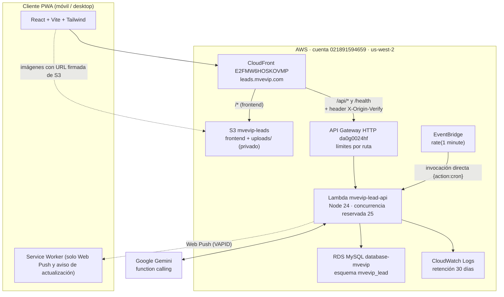

# MEMORIA TÉCNICA - MVEVIP LEAD REMINDER & ASISTENTE IA

**Proyecto:** MVEVIP Leads & Recordatorios (PWA)  
**Versión del frontend:** 1.0.7 (el backend no tiene número de versión; ver el historial de commits)  
**Dominio de producción:** [https://leads.mvevip.com](https://leads.mvevip.com)  
**Repositorios:**  
- Personal (respaldo y actividad): [https://github.com/caloloc2/mvevip_leads_agente](https://github.com/caloloc2/mvevip_leads_agente)  
- Empresa (colaborador principal): [https://github.com/mvevip/mvevip-leads-app](https://github.com/mvevip/mvevip-leads-app)  
**Última actualización:** 21 de octubre de 2026

> Este documento describe el sistema **tal como está desplegado hoy**. El historial de cambios y los pendientes están al final (secciones 10 y 11). Los procedimientos de operación (logs, desbloqueos, rotación de secretos, reversiones) están en la sección 7.

---

## 1. Resumen ejecutivo

MVEVIP Lead Reminder es una Aplicación Web Progresiva (PWA) para la fuerza comercial de MVEVIP. Centraliza la gestión de clientes potenciales (leads), citas y recordatorios, con notificaciones Web Push y un asistente conversacional impulsado por **Google Gemini** que consulta y modifica recordatorios mediante herramientas acotadas (function calling), por texto, voz o imágenes.

Hay 23 cuentas registradas. El pico observado de tráfico en la última semana fue de ~24 peticiones por minuto.

---

## 2. Arquitectura



**Flujo de una petición de la app:** el navegador llama a `https://leads.mvevip.com/api/...`; CloudFront reenvía al API Gateway agregando la cabecera secreta `X-Origin-Verify`; el API Gateway aplica los límites por ruta e invoca la Lambda; la Lambda verifica la cabecera, aplica los límites de intentos, autentica el JWT y responde.

**Modo local:** Docker Compose con puertos aislados (frontend `6410`, backend `6411`, MySQL `6412`).

---

## 3. Recursos en AWS

Todos los comandos usan el perfil de AWS CLI `marketingvip` y la región `us-west-2`.

| Recurso | Identificador | Detalle |
|---|---|---|
| **Dominio / certificado** | `leads.mvevip.com` | Certificado ACM `*.mvevip.com` (us-east-1), vence el **2027-02-13** |
| **CloudFront** | `E2FMW6HOSKOVMP` (`d372galked0u7s.cloudfront.net`) | Origen por defecto: S3 (OAC). `/api/*` y `/health` → API Gateway. Clase de precio 100. Sin WAF |
| **CloudFront Function** | `MarketingVIP-Router-us-west-2` | Compartida con otros proyectos (rutas `/pantalla`, `/admin`); reescribe rutas sin extensión a `/index.html` |
| **S3** | `mvevip-leads` | Acceso público bloqueado. Prefijos: `assets/`, `icons/`, `deployments/` (zips de la Lambda y `backup/`), `uploads/` (privado) |
| **API Gateway** | HTTP API `mvevip-lead-api-gw` (`da0g0024hf`) | Etapa `$default` con despliegue automático. Integración `qxqhxp8` (AWS_PROXY v2, 30 s) |
| **Lambda** | `mvevip-lead-api` | **Node.js 24.x** (desde el 21-oct-2026; antes 20.x) · 512 MB · 30 s · x86_64 · handler `lambda.handler` · sin VPC · **concurrencia reservada: 25** |
| **Rol de la Lambda** | `mvevip-api-leads-role-brclsbmj` | **Compartido** con la función `mvevip-api-leads` (otro sistema). Tiene `AmazonS3FullAccess` y la política inline `MvevipLeadApiLogs` |
| **Logs** | `/aws/lambda/mvevip-lead-api` | Retención de 30 días |
| **EventBridge** | regla `mvevip-lead-cron-rule` | `rate(1 minute)` → Lambda con `{"action":"cron"}` |
| **RDS** | `database-mvevip` (MySQL 8.4.8, `db.t4g.small`) | **Compartido con otros sistemas.** Esquema de esta app: `mvevip_lead`. Accesible públicamente (pendiente, ver sección 11) |
| **Usuario IAM** | `mvevip-leads-media-signer` | Solo `s3:GetObject` sobre `uploads/*`; sus claves firman las URLs de imágenes |

### 3.1. API Gateway: rutas y límites

| Ruta | Límite sostenido | Ráfaga |
|---|---|---|
| `$default` (todas las demás) | 30 por segundo | 60 |
| `POST /api/auth/login` | 5 por segundo | 10 |
| `POST /api/bot/turn` | 3 por segundo | 6 |
| `POST /api/bot/conversation` | 3 por segundo | 6 |

Los límites son **globales por ruta** y de **mejor esfuerzo**: frenan bien la carga sostenida, pero una ráfaga simultánea puede pasar parcialmente. La barrera dura contra ráfagas es la **concurrencia reservada de 25** de la Lambda (el exceso recibe 503). Esta función comparte con unas 25 funciones más un límite de 1.000 ejecuciones simultáneas de la cuenta; la reserva evita que un abuso afecte a esos otros sistemas. El máximo real observado en 7 días fue de 4.

### 3.2. Variables de entorno de la Lambda

| Variable | Descripción |
|---|---|
| `DATABASE_URL` | Cadena de conexión a `mvevip_lead` en RDS |
| `JWT_SECRET` | **Obligatoria**: sin ella la app no arranca (no hay valor por defecto en el código) |
| `JWT_EXPIRES_IN` | Vigencia del token (`5d`) |
| `GEMINI_API_KEY` | Clave de Google Gemini |
| `VAPID_PUBLIC_KEY`, `VAPID_PRIVATE_KEY`, `VAPID_SUBJECT` | Claves y contacto para Web Push |
| `TZ` | `America/Guayaquil` |
| `NODE_ENV` | `production` |
| `S3_BUCKET_NAME` | `mvevip-leads` |
| `CLOUDFRONT_DOMAIN` | `leads.mvevip.com` (dominio con el que se guardan las URLs en la base) |
| `MEDIA_SIGNER_ACCESS_KEY_ID`, `MEDIA_SIGNER_SECRET_ACCESS_KEY` | Claves del usuario IAM `mvevip-leads-media-signer` |
| `ORIGIN_VERIFY_SECRET` | Secreto de la cabecera `X-Origin-Verify` (debe coincidir con CloudFront) |
| `ORIGIN_VERIFY_MODE` | `enforce` en producción (`off` \| `log` \| `enforce`) |

Opcionales (no definidas en producción): `ORIGIN_VERIFY_SECRET_PREVIOUS` (rotación), `CORS_ORIGINS` (por defecto `https://leads.mvevip.com,http://localhost:6410`), `CRON_SECRET` (habilita la ruta HTTP del cron; sin ella responde 404). `.env.example` documenta todas.

> **Cuidado al editarlas:** `aws lambda update-function-configuration --environment` **reemplaza todas** las variables. Siempre se debe leer las actuales, combinar y escribir (ver 7.6). Nunca pegar valores secretos en chats o tickets.

---

## 4. Componentes del código

```
mvevip_lead_app/
├── client/                      # Frontend React + Vite PWA
│   ├── public/                  # sw.js, manifest.json, version.json, iconos
│   └── src/
│       ├── components/          # AssistantChatView, CalendarAgendaView, TimelineView, Header, modales...
│       ├── context/             # AuthContext, ThemeContext, UpdateContext
│       ├── pages/               # HomePage, LoginPage
│       └── services/            # api.js, pushService.js, soundService.js
├── server/                      # Backend Express (local) y handler de Lambda
│   ├── lambda.js                # Handler: distingue cron de EventBridge y peticiones HTTP
│   ├── prisma/                  # schema.prisma y seed.js
│   └── src/
│       ├── app.js               # Middlewares globales y manejo de errores
│       ├── server.js            # Servidor local (con node-cron)
│       ├── routes/api.js
│       ├── controllers/         # auth, reminder, bot, admin, push
│       ├── middleware/          # auth, originVerify, signMedia, cronAuth
│       ├── services/            # geminiService, cronScheduler, webPushService, s3Service
│       └── utils/               # logger, requestContext, clientIp, rateLimit, sessionVersion,
│                                # passwords, jwtConfig, prismaClient
└── deploy/
    ├── bucket-policy.json       # Política aplicada al bucket (OAC acotado + Deny a uploads/*)
    ├── cloudfront-config.json   # Configuración inicial de la distribución (referencia histórica)
    ├── database_setup.sql       # Esquema completo sincronizado con producción
    ├── migrations/              # Cambios posteriores, numerados
    ├── deploy-aws.ps1           # Despliegue de frontend y backend
    ├── package-lambda.ps1       # Empaquetado y verificación del zip de la Lambda
    └── eventbridge-targets.json
```

**Stack real:** React 19, Vite 6, Tailwind 4, Axios, date-fns, lucide-react · Node 24 en Lambda (los contenedores locales aún usan Node 20, ver 11.1), Express 4, Prisma 6.19 (MySQL), `@google/generative-ai` 0.24, `@codegenie/serverless-express`, `web-push`, `bcryptjs`, `jsonwebtoken`, `multer`, AWS SDK v3 (`client-s3`, `s3-request-presigner`). `node-cron` solo se usa en local; en producción el cron lo dispara EventBridge.

### 4.1. API

| Grupo | Rutas |
|---|---|
| Autenticación | `POST /api/auth/login`, `change-password`, `avatar`, `skip-first-login`; `GET /api/auth/profile` |
| Recordatorios | `GET/POST /api/reminders`; `GET /api/reminders/:id`; `PATCH :id/complete`, `reopen`, `dismiss`, `transfer`; `POST :id/followups` |
| Asistente | `GET/DELETE /api/bot/history`; `POST /api/bot/turn` (y `/api/bot/conversation`, alias) |
| Push | `GET /api/push/public-key`; `POST subscribe`, `unsubscribe`, `test` |
| Administración (solo ADMIN) | `GET/POST /api/admin/users`; `PATCH users/:id/role` (cambia ADMIN↔ASESOR); `PATCH users/:id/toggle-status`; `POST users/:id/reset-password`; `POST /api/admin/notifications`; `GET /api/admin/stats` |
| Cron | `GET /api/cron/check-reminders` (deshabilitada: 404 salvo que exista `CRON_SECRET`) |
| Salud | `GET /health` |

### 4.2. Asistente IA

- **Modelo:** `gemini-3.8-flash` (fijo en `geminiService.js`).
- **Herramientas (6), todas por Prisma, sin SQL libre:** `get_my_reminders`, `search_leads`, `get_lead_details`, `update_reminder`, `add_followup_note`, `create_reminder`. No existe ninguna herramienta de borrado: solo se puede descartar (`DISMISSED`) o completar.
- **Privacidad por rol:** un ASESOR solo accede a sus propios leads (filtro en el código). Un ADMIN ve por defecto solo los suyos y accede a otros asesores solo si lo pide explícitamente (esa parte depende del prompt, no del código).
- **Fechas:** los días se calculan siempre en hora de Quito (UTC-5 fijo), sin depender de la zona horaria del servidor.
- **Límites de tiempo:** timeout de 15 s por llamada a Gemini y presupuesto de 24 s por turno (el API Gateway corta a los 30 s). Un único reintento ante 429/503.
- **Rondas de herramientas:** hasta 3. Si el modelo sigue pidiendo herramientas o responde sin texto, se hace una llamada final **sin herramientas** pidiendo responder con lo ya obtenido. Nunca se entrega ni se guarda una respuesta vacía.
- **Bloqueos del filtro de contenido:** Gemini evalúa todo el contexto y da falsos positivos ocasionales (`PROHIBITED_CONTENT`). Si bloquea el primer llamado de un turno y hay historial, se reintenta una vez **sin historial**. Nunca se reintenta después de ejecutar herramientas (no se duplican escrituras). Los logs de error registran `blockReason`, `hasFile`, `fileType` (imagen o audio) e `historyMessages`.
- **Errores:** se clasifican (timeout, demanda alta, contenido bloqueado, respuesta vacía, genérico) y el usuario recibe un mensaje natural. El detalle técnico va solo a los logs. Los mensajes de error no se guardan en el historial.
- **Límite de uso:** 15 mensajes por minuto por usuario.
- **Historial:** se guarda en `chat_messages`; se omiten los mensajes vacíos al construir el contexto y al listarlos.

### 4.3. Frontend (resumen de funciones)

- **Estación de trabajo desktop (`lg ≥ 1024px`):** asistente a la izquierda y calendario/agenda a la derecha con scroll independiente. En móvil, `BottomNav` alterna entre Asistente y Agenda con gestos de deslizamiento.
- **Calendario y agenda:** `DayPicker` muestra la semana de lunes a domingo; `TimelineView` muestra franjas de 5 AM a 11 PM (agenda hasta las 12 AM, hora de Quito) y un bloque «Fuera de horario» (12–5 AM) que aparece solo si hay compromisos en ese tramo, para que ninguno quede oculto. El cron de notificaciones no tiene restricción de día ni hora: corre 24/7.
- **Cambio de tipo de usuario:** el panel de usuarios permite pasar un usuario de ADMIN a ASESOR y viceversa. Reglas: no se puede cambiar el propio tipo; no se puede degradar al último administrador activo; el cambio cierra las sesiones del usuario (`tokenVersion`) y le envía un aviso push; queda el log `role_changed` (actor, objetivo, de, a, sesiones cerradas). Los permisos los decide siempre el servidor según el rol en la base de datos.
- **Agenda multi-asesor:** los administradores filtran por uno, varios o todos los asesores; cada tarjeta muestra el asesor responsable.
- **Chat:** texto, notas de voz, fotos por selección, arrastrar y soltar, y pegado desde el portapapeles (`Ctrl + V`).
- **Notificaciones:** Web Push (VAPID) con sonido y vibración; compatible con iOS 16.4+ (PWA instalada) y Chrome en Android.
- **Visual móvil:** `theme-color` dinámico (claro/oscuro) y áreas seguras para notch.
- **Actualizaciones:** `UpdateContext` consulta `/version.json` y avisa de versiones nuevas.
- **Service Worker:** solo gestiona Web Push, el aviso de actualización y la limpieza de cachés antiguas. **No tiene manejador `fetch`: la app no funciona sin conexión.**

---

## 5. Base de datos

Esquema `mvevip_lead` (MySQL 8.4, `utf8mb4_unicode_ci`). Script completo: `deploy/database_setup.sql`. El esquema **no usa migraciones de Prisma** (no existe `_prisma_migrations`): los cambios se aplican con scripts SQL numerados en `deploy/migrations/`, ejecutados a mano.

| Tabla | Contenido |
|---|---|
| `users` | Cuentas (ADMIN / ASESOR). Incluye `isActive`, `mustChangePassword`, `isFirstLogin` y `tokenVersion` (versión de sesión) |
| `reminders` | Recordatorios y leads, con estado, prioridad, origen y `notificationSent` |
| `reminder_followups` | Bitácora de cada recordatorio |
| `reminder_tags`, `tags` | Etiquetas (hoy sin endpoints en el API) |
| `push_subscriptions` | Suscripciones Web Push por dispositivo |
| `chat_messages` | Historial del asistente por usuario |
| `rate_limit_events` | Contadores de los límites de intentos (claves en hash SHA-256; se purgan los de más de 24 h cada hora) |

**Migraciones aplicadas:** `001_rate_limit_and_token_version.sql` (21-oct-2026).

> Los objetos nuevos se consultan con SQL directo (`$queryRaw`) y con tolerancia a fallos, sin depender del cliente de Prisma generado. `schema.prisma` los documenta; el próximo `prisma generate` los incluirá.

---

## 6. Seguridad

| Capa | Medida |
|---|---|
| **Acceso directo al API Gateway** | La Lambda exige la cabecera secreta `X-Origin-Verify` que CloudFront agrega a cada petición (`ORIGIN_VERIFY_MODE=enforce`). Una llamada directa recibe 403. Se compara en tiempo constante y soporta rotación sin interrupción |
| **Autenticación** | JWT de 5 días. `JWT_SECRET` obligatorio. Contraseña de 8 a 72 caracteres; las temporales las genera `crypto` (formato `MVEVIP` + 8 caracteres sin ambiguos) |
| **Fuerza bruta** | Máximo 5 intentos fallidos en 15 min por correo + IP y 50 por IP. 429 con `Retry-After`. Contador compartido en la base de datos. Comparación bcrypt de relleno si el correo no existe; la cuenta deshabilitada solo se informa con la contraseña correcta |
| **IP del usuario** | Se usa `requestContext.http.sourceIp` del API Gateway. `X-Forwarded-For` y `CloudFront-Viewer-Address` **no son confiables** (se pueden falsificar llamando directo) |
| **Sesiones revocables** | `users.tokenVersion` va en el JWT. El reseteo de contraseña desde el panel admin lo incrementa e invalida los tokens anteriores en ≤ 30 s. Los tokens anteriores a la función valen como versión 0 |
| **Asistente** | Límite de 15 mensajes por minuto por usuario; sin herramientas de borrado; errores sin detalle técnico |
| **Archivos subidos** | Fotos de clientes y avatares **privados**: URLs firmadas de S3 (ver 6.1) |
| **Red** | CORS restringido a `https://leads.mvevip.com` y `http://localhost:6410`; límites por ruta en el API Gateway; concurrencia reservada |
| **Respuestas** | `X-Content-Type-Options: nosniff`, `Referrer-Policy: no-referrer`, `Cache-Control: no-store`; sin `X-Powered-By`; errores 4xx/5xx sin detalle interno y con `requestId` |
| **Tamaños** | JSON de 100 KB por defecto; hasta 6 MB solo en avatar, cambio de contraseña y alta de usuarios |
| **Cron HTTP** | Ruta deshabilitada salvo que exista `CRON_SECRET` |
| **Secretos** | Ningún `.env` ni secreto se versiona. Se guardan solo en variables de la Lambda y en CloudFront (el secreto de origen) |

### 6.1. Archivos subidos (`uploads/`)

- **Almacenamiento:** `s3://mvevip-leads/uploads/{chat-images|avatars}/<uuid>.<ext>` (nombres no adivinables). La base de datos guarda la URL canónica `https://leads.mvevip.com/uploads/...`.
- **Entrega:** un middleware reemplaza, en todas las respuestas JSON, los campos `avatarUrl`, `mediaUrl` e `images` por una URL firmada de S3 con vigencia de **24 a 25 horas**. La fecha de firma se redondea a la hora para que la URL sea estable y cacheable.
- **Acceso:** la política del bucket (`deploy/bucket-policy.json`) permite a CloudFront leer el bucket solo desde la distribución `E2FMW6HOSKOVMP` y **le deniega `uploads/*`**. Sin una URL firmada vigente no se puede ver ninguna foto.
- **Claves de firma:** del usuario IAM `mvevip-leads-media-signer` (solo lectura de `uploads/*`). Si faltan, se firma con el rol de la Lambda y las URLs duran menos (hasta que expiren sus credenciales temporales).
- **Al guardar:** si el cliente reenvía una URL firmada como avatar, se guarda sin firma.
- **Limitación:** una pestaña abierta más de un día mostrará las fotos del chat rotas hasta recargar.

---

## 7. Operación

### 7.1. Logs y búsquedas útiles
Los logs son líneas JSON en `/aws/lambda/mvevip-lead-api`.

```powershell
# Seguir los logs en vivo
aws logs tail /aws/lambda/mvevip-lead-api --since 30m --follow --region us-west-2 --profile marketingvip

# Solo errores
aws logs filter-log-events --log-group-name /aws/lambda/mvevip-lead-api --start-time <epoch_ms> --filter-pattern '"\"level\":\"error\""' --region us-west-2 --profile marketingvip
```

| `stage` | Significado |
|---|---|
| `http` | Error HTTP (4xx en `warn`, 5xx en `error`) con `requestId` |
| `assistant_turn` | Un turno del asistente: duración, llamadas a Gemini, `forcedAnswer`, herramientas y parámetros no sensibles |
| `tool:<nombre>`, `gemini_retry`, `gemini_not_configured` | Fallos de herramientas o de Gemini |
| `gemini_blocked_retry` | Gemini bloqueó el primer llamado de un turno y se reintentó sin historial (incluye `blockReason` e `historyMessages`) |
| `push_delivery_failed`, `push_send`, `push_broadcast` | Envíos push fallidos por dispositivo (`statusCode`, si la suscripción se eliminó) o error general; nunca incluyen el endpoint ni el contenido |
| `bot_turn` | Fallo del controlador del asistente |
| `login_failed`, `login_rate_limited` | Seguridad del login (incluyen la IP) |
| `rate_limit_*`, `token_version_*` | Fallos de las tablas del limitador o de `tokenVersion` (el sistema sigue funcionando sin límite) |
| `origin_verify_failed` | Petición sin la cabecera de origen válida (en `enforce` se rechaza con 403) |
| `sign_media` | Fallo al firmar una URL (se responde sin firmar) |

Si un usuario reporta un error, el `requestId` que recibió en la respuesta 500 coincide con el `RequestId` del log.

### 7.2. Desbloquear un login
Esperar 15 minutos, o ejecutar `DELETE FROM rate_limit_events;` en `mvevip_lead` (borra todos los contadores).

### 7.3. Cerrar las sesiones de un usuario
Resetear su contraseña desde el panel de administración (incrementa `tokenVersion`). Desactivar la cuenta también la bloquea en la siguiente petición.

### 7.4. Modos de la verificación de origen
`enforce` rechaza el acceso directo. Si CloudFront dejara de enviar la cabecera y la app dejara de funcionar, se pasa `ORIGIN_VERIFY_MODE` a `log` (registra sin bloquear) o `off` con el procedimiento de 7.6; no requiere redeploy.

### 7.5. Rotar el secreto de origen (sin interrupción)
1. En la Lambda: `ORIGIN_VERIFY_SECRET_PREVIOUS` = secreto actual y `ORIGIN_VERIFY_SECRET` = secreto nuevo.
2. CloudFront → Origins → `ApiGatewayOrigin` → Edit → cambiar el valor de `X-Origin-Verify` por el nuevo. Esperar el estado **Deployed**.
3. Verificar en los logs que no hay `origin_verify_failed` del tráfico de la app.
4. Quitar `ORIGIN_VERIFY_SECRET_PREVIOUS`.

El secreto se genera en la máquina del operador y no debe pasar por chats ni tickets.

### 7.6. Editar variables de entorno de la Lambda (sin perder las demás)
```powershell
$cfg = aws lambda get-function-configuration --function-name mvevip-lead-api --region us-west-2 --profile marketingvip | ConvertFrom-Json
$vars = @{}
$cfg.Environment.Variables.PSObject.Properties | ForEach-Object { $vars[$_.Name] = $_.Value }
"Variables actuales: $($vars.Count)"      # verificar el total antes de seguir

$vars["ORIGIN_VERIFY_MODE"] = "log"       # ejemplo: la variable a cambiar

$json = @{ Variables = $vars } | ConvertTo-Json -Depth 5
[System.IO.File]::WriteAllText("$PWD\lambda-env.json", $json, (New-Object System.Text.UTF8Encoding $false))
aws lambda update-function-configuration --function-name mvevip-lead-api --environment file://lambda-env.json --region us-west-2 --profile marketingvip --query "[LastUpdateStatus,length(Environment.Variables)]" --output text
Remove-Item lambda-env.json                # el archivo contiene todos los secretos
```

### 7.7. Invalidar la caché de CloudFront
```powershell
aws cloudfront create-invalidation --distribution-id E2FMW6HOSKOVMP --paths "/uploads/*" --profile marketingvip
```
CloudFront guarda en caché 24 h por defecto; tras cambiar permisos de `uploads/`, invalidar.

---

## 8. Despliegue

### 8.1. Procedimiento oficial
```powershell
.\deploy\deploy-aws.ps1 -DeployBackend     # backend (Lambda) + frontend (S3) + invalidación de CloudFront
.\deploy\deploy-aws.ps1                    # solo frontend
```
`package-lambda.ps1`:
1. Ejecuta `npm install` dentro del contenedor `mvevip_lead_server`.
2. Genera el cliente de Prisma para `rhel-openssl-3.0.x`.
3. Empaqueta en `deploy/lambda-backend.zip`.
4. **Verifica el contenido del zip:** exige `lambda.js`, `src/app.js`, el motor de Prisma y **cada dependencia de `package.json`**. Si falta algo, descarta el zip y aborta.

> **Por qué el `npm install` y la verificación:** el contenedor monta `/app/node_modules` como volumen anónimo, por lo que una dependencia nueva de `package.json` no aparece ahí hasta instalarla (reconstruir la imagen no renueva ese volumen). Sin esos pasos, el zip salía sin la dependencia y la Lambda **fallaba al arrancar**. Esto ocurriría con `@aws-sdk/s3-request-presigner`, que se agregó el 21-oct-2026.

### 8.2. Antes y después de desplegar el backend
- **Antes:** copiar el zip actual como respaldo: `aws s3 cp s3://mvevip-leads/deployments/lambda-backend.zip s3://mvevip-leads/deployments/backup/lambda-backend-<fecha>-<motivo>.zip`. Hoy hay 8 respaldos en `deployments/backup/`.
- **Después:** comprobar `GET /health`, que no haya errores en los logs, que el cron siga corriendo (`Invocación por EventBridge` cada minuto) y que `Errors` y `Throttles` de la Lambda estén en 0.
- **Cambios de esquema:** ejecutar primero el script SQL (los scripts son compatibles con el código anterior) y después desplegar.

### 8.3. Revertir
```powershell
aws lambda update-function-code --function-name mvevip-lead-api --s3-bucket mvevip-leads --s3-key deployments/backup/<zip-de-respaldo>.zip --region us-west-2 --profile marketingvip
```
Verificar con `get-function-configuration` que `LastUpdateStatus` sea `Successful` y que el `CodeSha256` cambió.

### 8.4. Frontend
`deploy-aws.ps1` compila con Vite dentro del contenedor (el `client/package-lock.json` fija las versiones; tras traer cambios de dependencias ejecutar `docker exec mvevip_lead_client npm install`, no `npm ci`, porque `node_modules` es un volumen anónimo), sincroniza a S3 (con `no-cache` en `index.html`, `sw.js` y `version.json`) e invalida CloudFront. Al publicar una versión nueva se debe actualizar a la vez `client/src/version.js`, `client/public/version.json` y `CACHE_NAME` en `client/public/sw.js`.

### 8.5. GitHub Actions (en implantación)
Archivos: `.github/workflows/ci.yml` (sintaxis, carga de la app, empaquetado verificado, build del cliente, coherencia de versiones), `deploy.yml` (manual, con aprobación; respaldo automático, hash, `/health`, logs) y `rollback.yml`. Scripts en `deploy/ci/`; políticas IAM en `deploy/iam/`.

**Pasos de configuración pendientes (una sola vez):**
1. AWS: crear el proveedor OIDC `token.actions.githubusercontent.com` (hoy no existe en la cuenta) y el rol `mvevip-leads-github-deploy` con `deploy/iam/github-deploy-trust.json` y `github-deploy-policy.json`.
2. GitHub: environment `production` con revisores requeridos; variables `AWS_DEPLOY_ROLE_ARN` y `VITE_VAPID_PUBLIC_KEY` (la clave pública de la Lambda).
3. Primer despliegue de prueba con `target=frontend`, luego `backend`.

---

## 9. Pruebas

El repositorio **no tiene pruebas automatizadas**. Durante la sesión del 21-oct-2026 se validó cada cambio con pruebas locales descartables (Express, bcrypt y JWT reales, con Prisma, S3 y Gemini simulados) y con comprobaciones en producción mediante logs y métricas de CloudWatch. Incorporar una suite en el repositorio está entre los pendientes.

---

## 10. Historial de cambios

### Versiones del frontend
- **1.0.7 (21-oct-2026):** calendario de lunes a domingo, de 5 AM a 12 AM, con bloque «Fuera de horario»; cambio de tipo de usuario (Administrador/Asesor) en el panel de usuarios; `package-lock.json` del cliente.
- **1.0.6 (12-oct-2026):** asistente a la izquierda y calendario a la derecha en desktop.
- **1.0.5 (12-oct-2026):** estación de trabajo desktop, sonido y vibración en push, arrastrar y soltar y pegado de imágenes en el chat.
- **1.0.4 y anteriores:** asistente con Gemini, agenda multi-asesor, ajustes móviles, resolución del bucle de actualización de la PWA.

### Sesión de endurecimiento del 21-oct-2026 (backend y AWS)
| Commit | Cambio |
|---|---|
| `490aad5` | Notificaciones push: reclamo atómico (sin envíos dobles) y reintento durante 15 minutos |
| `c61f112` | Errores: logs estructurados, mensajes seguros, timeouts de Gemini, 4xx correctos |
| `4963b97` | URLs firmadas para fotos y avatares; nombres UUID |
| `17d6ebf` | Política del bucket con `uploads/` privado y `.env.example` |
| `09310e1` / `9dfed1a` | Límite de intentos, sesiones revocables, CORS, cabeceras, tamaños, contraseñas; corrección de la IP detectada |
| `be72b84` / `006f9a5` | Verificación de origen CloudFront → API Gateway |
| `8cc1f94` | Asistente sin respuestas vacías, fechas en hora de Quito, historial sin mensajes vacíos |
| `25db1c2` / `90a9582` | Documentación; el empaquetado de la Lambda verifica el contenido del zip; revisión de compatibilidad con Node 22/24 |

| `61473c3` | Reintento sin historial ante bloqueos del filtro de Gemini; logs de diagnóstico del asistente y de push por dispositivo |
| `07ece8e` | Frontend 1.0.7: calendario de lunes a domingo (5 AM a 12 AM); endpoint `PATCH /api/admin/users/:id/role` y botón de cambio de tipo de usuario; `client/package-lock.json` |

**Runtime:** la Lambda pasó de `nodejs20.x` a `nodejs24.x` (cambio solo de configuración, sin redeploy de código).

**Despliegue de la 1.0.7 (21-oct-2026, 22:35 UTC):** backend por parche del zip (solo `adminController.js` y `api.js`; respaldo en `deployments/backup/lambda-backend-2026-10-21-pre-roles.zip`) y frontend compilado con Node 24 (idéntico byte a byte al compilado con Node 20) y subido a S3 con `no-cache` en `index.html`, `sw.js` y `version.json`; respaldo de los archivos anteriores en `deployments/backup/frontend-2026-10-21/`. El bundle se compila con `VITE_VAPID_PUBLIC_KEY` (la clave pública de la Lambda): el repo no la incluye (`client/.env.production` solo tiene `VITE_API_URL`), así que cualquier compilación fuera del contenedor debe definirla. Verificado: hash de la Lambda, `/health`, 0 errores, cron activo, `version.json` 1.0.7 y login sin errores de consola. Los cambios viven en la rama `claude/loving-mendel-okleeo` (aún no están en `main`).

**Cambios en AWS y en la base de datos:** log group con retención de 30 días y permiso de logs en el rol; usuario IAM `mvevip-leads-media-signer`; variables de entorno nuevas; política del bucket con `Deny` a `uploads/*`; invalidación de `/uploads/*`; header `X-Origin-Verify` en `ApiGatewayOrigin`; 3 rutas con límites en el API Gateway; concurrencia reservada de 25; migración SQL 001.

---

## 11. Pendientes y limitaciones conocidas

### 11.1. Pendientes, por prioridad
| # | Pendiente | Detalle |
|---|---|---|
| 0 | **Despliegue controlado con GitHub Actions (EN CURSO: workflows escritos, falta configurar AWS y GitHub, ver 8.5)** | Hoy se despliega a mano (PowerShell/Docker o parche del zip desde la sesión de Claude). Objetivo: flujo en GitHub Actions con pruebas previas, entorno con aprobación manual, credenciales por OIDC hacia un rol de IAM mínimo (sin claves largas), respaldo automático del zip y de los archivos previos, verificación del hash, `/health` y logs tras el despliegue, y reversión con un clic. Incluye decidir si la rama `claude/loving-mendel-okleeo` se integra a `main` por PR. Compilar el frontend con `VITE_VAPID_PUBLIC_KEY` |
| 1 | **Runtime Node 24: hecho en producción (21-oct-2026). Falta alinear los contenedores locales** | `server/Dockerfile` y `client/Dockerfile` siguen en `node:20-alpine`: pasarlos a `node:24-alpine` y recrear el volumen de `node_modules` (`docker compose up -d --build -V`). Contexto: `nodejs20.x` **ya estaba deprecado** (30-abr-2026): AWS puede dejar de aplicarle parches de seguridad y la función no tiene soporte técnico. Hitos oficiales: bloqueo de creación de funciones el 29-jul-2027 y **bloqueo de actualizaciones el 31-ago-2027** (después no se podría ni corregir un error). El SDK de AWS v3 exigirá Node 22 desde la primera semana de enero de 2027 (afecta solo a actualizaciones futuras del SDK). Se recomienda **Node 24** (soportado hasta el 30-abr-2028); `nodejs22.x` se deprecaría el 30-abr-2027. La cuenta ya tiene 12 funciones en Node 24 y 6 en Node 22. Revisión de compatibilidad hecha el 21-oct-2026: ver 11.3 |
| 2 | **403 y 404 del API llegan como HTML con 200** | CloudFront tiene respuestas de error personalizadas (403/404 → `index.html`) que aplican también a `/api/*`. Afecta, por ejemplo, a los mensajes "No autorizado". Corregir con cuidado: la CloudFront Function es compartida |
| 3 | **Rol compartido con `AmazonS3FullAccess`** | Crear un rol propio para esta función con acceso solo a `uploads/*` |
| 4 | **Alarmas y logs de acceso** | Alarmas de `Errors`, 5xx y `Duration`; logs de acceso del API Gateway |
| 5 | **Latencia del asistente** | Casos normales de 5 a 9 s; una consulta compleja puede acercarse al límite de 24 s. Opciones: instrucción de sistema nativa, historial más corto, menos rondas |
| 6 | **Un solo cliente de Prisma** | Hay 9 instancias, que multiplican las conexiones al RDS compartido (pico observado: 45) |
| 7 | **Frontend** | Validar 8 caracteres en el cambio de contraseña (hoy valida 6 en el navegador); las contraseñas temporales de alta de usuario las genera el navegador con `Math.random`; revocar las sesiones de otros dispositivos al cambiar la contraseña propia (requiere entregar un token nuevo); iconos PNG para PWA y notificaciones (`/icons/icon-192.png` y `badge-72.png` no existen); aviso cuando una imagen del chat expira |
| 8 | **RDS expuesto** | `PubliclyAccessible=true` y un security group abierto a `0.0.0.0/0` en el 3306. Otros sistemas dependen de esa conexión: se resolverá en una sesión dedicada |
| 9 | **Seed con credenciales** | `deploy/database_setup.sql` incluye el correo del administrador y el hash bcrypt de su contraseña temporal inicial. Rotar la contraseña y retirar el hash del repositorio |
| 10 | **Pruebas automatizadas** | El repositorio no tiene pruebas; las de esta sesión viven fuera del repo. Incorporarlas (la CI/CD es el pendiente 0) |
| 11 | **Código muerto** | `GeminiBotModal.jsx` y `ProjectCard.jsx` no se importan en ningún lugar; el valor `TRANSFERRED` del enum y las tablas de etiquetas no tienen uso; `/api/bot/conversation` duplica a `/api/bot/turn`; `vite-plugin-pwa` está instalado pero no se usa |
| 12 | **Audio, WhatsApp, métricas en el chat, geolocalización** | Funcionalidades futuras (prioridad media a baja) |

### 11.2. Dependencias (`npm audit`, 21-oct-2026)
- **`multer` 1.4.5-lts.2** (carga de archivos del asistente): el registro de npm lo marca como obsoleto por vulnerabilidades corregidas en la 2.x. Pendiente de actualizar a 2.x y probar la subida de imágenes y notas de voz.
- **3 hallazgos "high"** en `prisma`, `@prisma/config` y `deepmerge-ts`: pertenecen a la CLI de Prisma (herramienta de desarrollo), que **no se empaqueta** en la Lambda.
- **2 "moderate"** en `node-cron` y `uuid`: `node-cron` solo se usa en desarrollo local.

### 11.3. Compatibilidad con Node 22 y 24 (revisión del 21-oct-2026)
- Los 202 paquetes del árbol de producción declaran `engines` compatibles con Node 20, 22 y 24 (0 incompatibles).
- No hay módulos nativos propios fuera del motor de Prisma (6.19.3), que carga y ejecuta correctamente bajo Node 22.22 y 24.22 con el binario `rhel-openssl-3.0.x`. Node 20, 22 y 24 usan el mismo sistema operativo en Lambda (Amazon Linux 2023).
- La batería de pruebas locales (cron, asistente, errores, seguridad, origen, imágenes) pasa completa bajo Node 22 y 24, y la firma SigV4 de las URLs coincide con la implementación independiente. No aparece ninguna advertencia de deprecación al cargar la app.
- El frontend compila con Vite 6 bajo Node 24.
- `server/Dockerfile` y `client/Dockerfile` usan `node:20-alpine`: alinear con la versión elegida (y recrear el volumen anónimo de `node_modules`).
- **Cambio aplicado en producción el 21-oct-2026 (21:55 UTC)** con `aws lambda update-function-configuration --runtime nodejs24.x` (solo cambia el runtime: las variables de entorno y el código no se tocan). Verificado después del cambio: arranque con `nodejs:24.mainline`, `Init Duration` de ~725 ms (antes 580 a 710 ms), login inválido por CloudFront (Prisma y RDS operativos), cron cada minuto, acceso directo al API Gateway rechazado, sin la advertencia del SDK de AWS y sin errores ni throttles. **Reversión:** `aws lambda update-function-configuration --function-name mvevip-lead-api --runtime nodejs20.x` (AWS permite volver a Node 20 hasta el 31-ago-2027).

### 11.4. Limitaciones conocidas
- La app no funciona sin conexión (el Service Worker no guarda en caché).
- Las URLs de imágenes duran 24 a 25 horas: una pestaña abierta más de un día requiere recargar.
- Los límites del API Gateway son de mejor esfuerzo; la barrera dura es la concurrencia reservada (25).
- Con el límite de 25 ejecuciones simultáneas, una avalancha de consultas lentas al asistente podría ocupar todos los cupos.
- La revocación de sesiones tarda hasta 30 s en aplicarse en cada contenedor de la Lambda.
- El aislamiento de un ADMIN que consulta solo sus propios leads por defecto depende del prompt del asistente, no del código.
